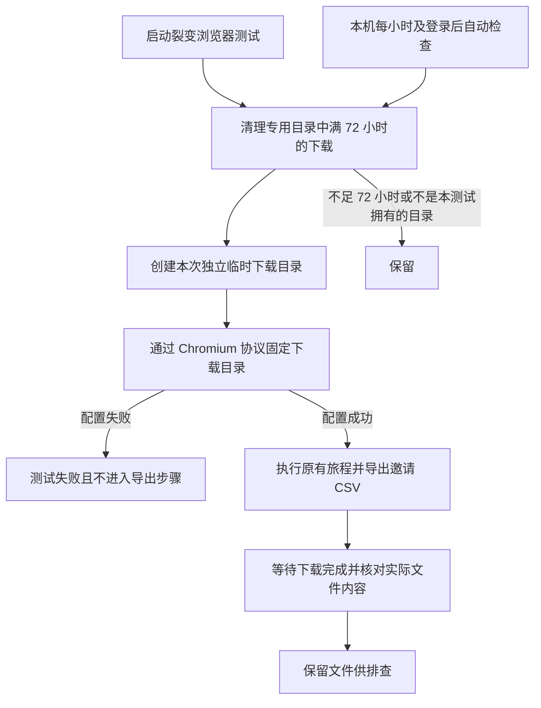

# 裂变测试下载隔离与 72 小时清理 PRD / 实施计划

用户已授权：修复测试脚本，下载保存到临时目录，72 小时自动清理，删除已核实的六份测试 CSV。

## 业务判断与根因

六份 CSV 的来源均为本机 HTTPS 测试服务器，文件内容与 `TestPostgreSQLReferralChromiumJourney` 的合成参与人一致。脚本模拟点击导出，却没有设置下载目录；临时浏览器 profile 不等于临时下载目录。

## 参考与复用

- [Chromium Browser.setDownloadBehavior](https://chromedevtools.github.io/devtools-protocol/tot/Browser/#method-setDownloadBehavior)：显式指定 downloadPath，并开启下载事件。
- [Node 文件系统 API](https://nodejs.org/api/fs.html)：mkdtemp 创建独立目录，lstat 区分链接，rm 清理文件。
- 复用本仓 `internal/webshell/owner_handoff_chromium.test.mjs` 的 Chromium 下载目录做法、既有裂变真实 PostgreSQL/浏览器旅程、macOS LaunchAgent。仅启动时清理不能满足无后续测试时仍自动清理，故安装本机定期清理入口。

## 范围、边界与限制

OneID：不涉及，本次不改变客户身份和归属。Persistence：本机测试临时文件，不是数据库事务或内部业务持久任务。External Effects：不涉及 Provider 写入。页面与产品导出合同不改变，不涉及 UI 编码。

下载根固定为系统临时目录下 `aicrm-referral-test-downloads`，每次运行创建独立 `run-*` 目录并写入归属标记。只删除拥有有效标记且最后文件活动满 72 小时的目录；根目录或标记为符号链接时不跟随。72 小时来自用户明确要求，删除范围约束用于避免误删用户文件。

本机 LaunchAgent 每小时以及登录时调用稳定安装路径的清理器；到期后下一次检查清理。电脑睡眠或关机期间不执行，恢复后继续。清理器不扫描 Downloads。既有六份 CSV 按准确名称、哈希与测试内容再次确认后一次性删除。

## 实施与验证

1. 新增专用临时下载/清理 helper `internal/webshell/test_referral_downloads.mjs` 与本机清理器安装脚本 `scripts/test-referral-download-cleanup-install.py`。遵循现有测试命名，分类为 source-only；不修改发布政策。
2. 原旅程在导航前固定下载目录，等待 CSV 真正下载完成，并验证表头、合成邀请人和参与人。
3. 验证独立目录、72 小时边界、新文件保留、不跟随链接、不删除无归属目录；运行真实 PostgreSQL/Chromium 旅程，对比 Downloads 前后无新增。
4. 安装并读回 LaunchAgent，模拟一个超期下载并由已安装入口清理，再删除六份旧 CSV。
5. 提交短检查清单，推送国内候选并交接唯一工作台。仅推进源码，不构建或安装生产应用。

五项影响：外部接口/产品输出不变；业务机制不变；直接消费者为裂变浏览器旅程与本机清理入口；页面不变；证据为目录清理合同、真实 CSV 下载及本机调度读回。回退仅需还原测试代码并卸载该本机 LaunchAgent；无数据库迁移。

## 已授权基线接续

原候选 a42ce66 / 1657de0 保留审计。工作台回传准确累计 base `d65f512849154b21416d8c8cea7964d4b6ddcc81` 后，仅接续上述测试输出修改。保留该 base 的海报 JPEG 1250×2426、QR、双视口、1MiB 素材及实际导出断言，以及商品图片、问卷、零元行为。冲突只合并网络方法记录与下载完成记录；原断言逐行比对保留。既有本机清理任务和六文件删除结果不重复执行，源码-only 候选不构建或安装应用，不新增发布定时器。

## 已授权失败修复：绑定当前 CSV 的下载 GUID

安装包 `83b5e8cb0e858b4f20f9237b10b19e8c9018314e` 的唯一失败为 CSV 路径 ENOENT；测试把任意下载的 completed 与推测的人类文件名混用。复用原授权，从该准确累计 base 只修下载测试。

[Chromium 官方协议](https://raw.githubusercontent.com/ChromeDevTools/devtools-protocol/master/json/browser_protocol.json) 明确区分建议文件名与实际落盘名；`allowAndName` 按下载 GUID 命名。因此改为：观察本次导出按钮实际触发的唯一 CSV anchor/blob URL → 匹配 `downloadWillBegin` 的 URL/建议名及 GUID → 只接受同一 GUID 的 completed → 检查临时目录内该 GUID 的真实普通文件 → 保留原 BOM、表头、指定邀请人行与 participation 筛选断言。不以其他下载或其他 CSV 兜底，不改 CRM 运行时。

相关短清单仅包含新下载绑定合同与原失败的具名 PostgreSQL/Chromium 旅程。验证其他 GUID、错误 URL、取消、重复开始、缺失落盘文件与链接文件均不能算通过；保留已有 72 小时清理规则及全部业务断言，沿用既有清理任务，不重装应用或扩大预发检查范围。

该具名旅程登记为 `browser` lane，由运行器设置 Chromium 必需标志；Node 绑定合同登记为 `frontend`。缺少 `AICRM_REQUIRE_CHROMIUM_JOURNEY=1` 而 skip 不算通过。`installed_checks=[]`，工作台仅在既有安装包上独立重跑失败旅程并保留其他通过收据。

## 已授权 Linux 事件路由修复

348 安装态复验仅能证明没有匹配的 downloadWillBegin；因当时未保存事件计数，不能推出完全没有 Browser 事件。[Playwright 的 Chromium 实现](https://raw.githubusercontent.com/microsoft/playwright/main/packages/playwright-core/src/server/chromium/crBrowser.ts) 在 connection.rootSession 订阅 Browser 下载事件并配置下载行为。本次复用这一标准路由：从 Chrome `/json/version` 获取 browser-target WebSocket，独立连接、配置与订阅下载事件；page-target 只继续原 Runtime/Network/DOM 处理。

失败时保存仅含测试浏览器版本、连接种类、开始/进度事件数量、URL/文件名匹配布尔值与匹配 GUID 状态的诊断。不输出原始 URL、建议名、headers、cookies 或环境变量。保持严格 blob/GUID/真实隔离文件与 CSV/参与范围断言、原 5 秒等待和 72 小时清理策略。只新增浏览器连接合同和事件诊断合同，独立重跑原失败旅程，不修改应用或其他验收阶段。
