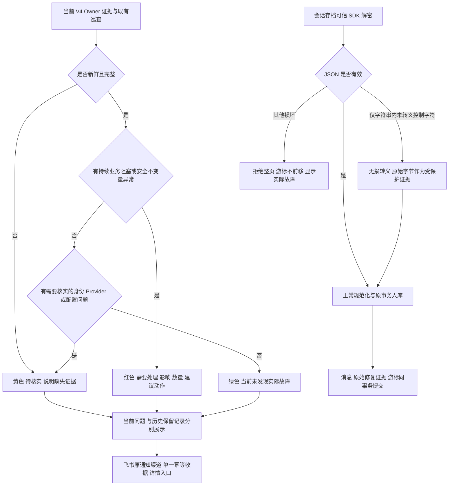

# 生产运行治理修复与可读通知

用户授权：本任务 01a130ac-4c5d-7440-8a24-c7716ac45d7f，2026-10-12 明确要求解决系统层级实际问题并部署生产，同时优化现有飞书巡查通知。复用当前运行治理，不增加发布通道。

## 事实与范围

- 生产 83b5e8c：存档游标 94555 最后成功于 10/9 23:05。当前页 94556、94558 解密内容存在未转义控制字符；100 条正常 Provider 读取、RSA 和 SDK 解密成功，98 条 JSON 有效。修复不能跳过消息或改写其文本。
- 1264 条自动化均 Provider 接受，但聚合一直 executing。接受事实与送达事实保持区分；已完成系统执行的记录不列成执行超时。
- 7 个群详情读失败需核对官方响应再处理；不能把业务权限或已失效群凭空变成系统恢复。
- release-cleanup/governance-releases 均停在 9/25 旧 SHA。由唯一工作台恢复当前可验证证据桥，缺证据仍显示黄色。
- 累计失败计数（联系人描述、历史同步、人群被替代、旧素材）不代表当前阻塞。身份冲突、资金 unknown 保留待核实，不自动合并或重写效果。

## 参考与复用

- [RFC 8259 字符串规范](https://www.rfc-editor.org/rfc/rfc8259#section-7)：控制字符须转义。只修复该明确缺陷，其他非法 JSON 继续拒绝。
- [Prometheus 告警实践](https://prometheus.io/docs/practices/alerting/)：按用户影响和可行动症状组织通知，不把所有原因参数平铺。
- [飞书自定义机器人](https://open.feishu.cn/document/client-docs/bot-v3/add-custom-bot)：复用 interactive card 原生红/橙/绿标题与 Markdown，仍走现有 Feishu Adapter/EER。
- Product Design get-context 已应用：现有飞书通知为设计目标；用户目标是几秒内知道是否关注、关注什么。采用结论、影响与行动、历史与缺口、详情四层；颜色同时配中文标签，避免只靠颜色辨认。复用已冻结报告及现有后台报告阅读入口。

## 边界

OneID：仅读既有冲突计数；不改身份匹配、客户根或合并机制。

Persistence：存档消息、修复原始字节与游标原子提交；内部执行继续复用现有 Inbox/River，不自建队列。治理只在 Owner 表读取脱敏计数。无需业务 schema 迁移。

External Effects：存档、群目录仅 Provider 读取；飞书通知经现有 adminops EER 幂等收据。历史资金/消息 unknown 不重发；Provider 接受与群内可见分别验收。

限制判断：存档恢复入口复用 OS root 运维权限，明确一个已有通知 ID 与 expected attempt；否则可重放其他业务或覆盖并发处理。只允许失败的已认证存档通知，仍调用原 Inbox CAS 重试并与最小审计同事务；不引入新的队列、定时器或 Provider 写入。其他消息体、鉴权、收据、防重和机密边界沿用现有合同。

补充核实：7 个群的当前官方响应均为 60011 权限拒绝。系统修复停止此类非重试错误的重复任务，并在通知列为权限待核实；不扩大企微授权。自动化原接口是员工群发任务，Provider 接受后仍等待员工发送/送达事实，保留业务状态，仅修正系统超时判断。

前端复用：现有 `/admin/ops` → governanceAdmin →共享 DetailDrawer；卡片在原报告抽屉安全地按文本显示中文摘要与状态色，旧文本报告继续可读。Product Design get-context/audit 当前报告首屏确认参数过密，截图在本任务仓外 design/01-original-report.jpg；不增加页面或平行组件。

## 验收与五项影响

1. 存档：正常内容逐字保留；字符串内控制字符无损转义；损坏结构仍拒绝；原始 bytes 与修复后消息同事务保留。重复拉取不重复入库，失败不移动游标。生产独立核对游标与新入库，不输出聊天明文。
2. 自动化：系统执行终态与送达证据分开；仅接受并无在途工作不报执行超时；unknown/failed 与真实在途仍告警。
3. 治理：新增存档/群目录 Owner 健康，历史计数保持详情可查；缺证据不伪报正常。
4. 通知：红色实际故障、黄色待核实/采集缺口、绿色当前无实际故障；首屏含具体影响与行动。固定小时窗口、冻结内容、重放幂等、签名、防敏感泄漏合同保持。
5. 页面：现有报告查看兼容新卡片，显示同一摘要；只改直接消费者，不进行无关页面重构。

验证选择实际变更包和直接消费者，PG/安装旅程在所需环境一次。准确 base/head/tree/ref、检查与未验证项交付唯一工作台；工作台同批一次构建、预发、相关冒烟、已有授权同包生产，独立读回。失败只修对应范围；普通发布无数据库备份。回退应用仍须满足 schema/构件兼容；本次无需 schema 变化。

生产补查：人群最新失败来自 package 19，已于 9/20 archived；17 个 active 包没有最新失败。当前异常仅统计未归档包，仍保留所有历史失败；真实 active 失败及恢复由 PG 用例验证。
