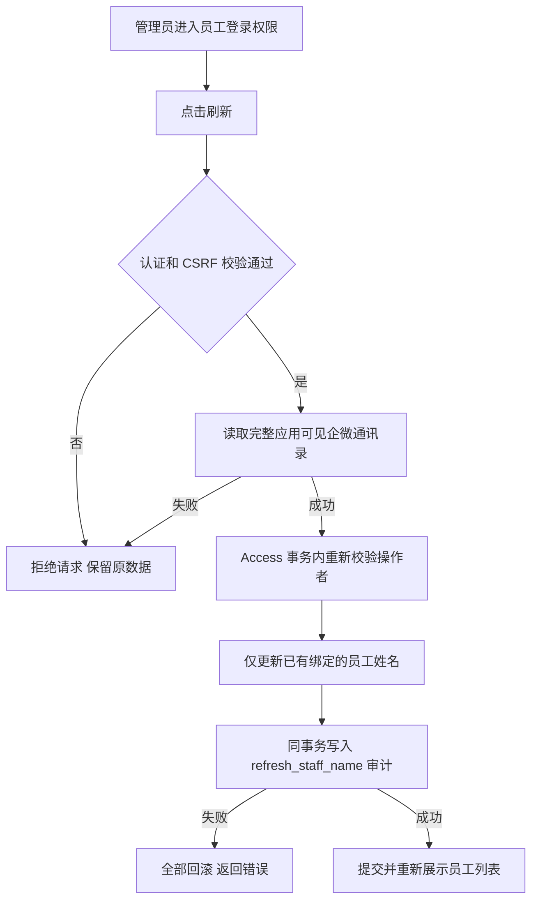

# 员工登录权限刷新失败修复

范围：修复后台访问页面刷新员工姓名返回 500。用户已要求排查并解决；2026-10-12 发布工作台最新人类指令要求本批统一预部署，生产待本批最终授权。

生产证据：应用 SHA `8245526b89d04111acb2b03f66416b9c10d4064e`；真实登录页面点击刷新，`POST /api/admin/access/users/refresh-names` 返回 500 / `internal_error`。当前安装包 `check-enterprise-directory` 返回 complete=true、employee_count=46；生产 `ck_admin_access_audit_action` 缺少代码已使用的 `refresh_staff_name`。这使姓名与审计事务一起回滚。现有纯内存测试未覆盖真实数据库约束。

参考与复用：已检索 [wecom-go-sdk 部门读取实现](https://github.com/go-laoji/wecom-go-sdk/blob/develop/department.go) 和 [wecom-sdk 成员读取 API](https://github.com/dlldsys/wecom-sdk)，均把通讯录读取作为独立 Provider 读取。复用本仓 WeCom Adapter、Access StaffNameWriter、Access Unit of Work 与审计，不改读取方式。官方文档本次网页读取不可用，生产安装包聚合预检直接验证真实 Provider。方案选择新增前向迁移扩展允许动作；复用其他审计动作会歪曲操作含义，去掉审计会失去追踪，因此不采用。

分类：OneID 不涉及客户归属或匹配，已有企微员工绑定继续由 Access 管理；Persistence 为 Provider read + Access 本地事务；External Effects 无 Provider 写入，无新增队列或执行内核；不涉及新增限制。

五项影响：对外接口、错误合同不变，正常刷新恢复成功；机制只扩展 Access 审计动作约束；直接消费者是 RefreshStaffNames → SetStaffDisplayName / AppendAccessAudit → PostgreSQL；页面继续复用 admin_access，Product Design 审核刷新与管理入口，不新增 UI；验证使用真实 PostgreSQL 与真实 HTTP 路由，断言权限/账号数/会话不变、重复刷新不重复审计、拒绝未授权/CSRF 与失败全量回滚。

迁移：Owner Access；保留所有账号、角色、会话和审计，前向兼容旧应用。不回改已发布迁移。生产迁移前按唯一工作台流程备份。回退应用可保留扩展后的约束，不能删已有审计事实。

验收：局部 PostgreSQL 用例先复现约束错误，再应用新增迁移验证成功；最终批次安装包预发验证真实认证刷新接口、员工姓名与审计读回及权限不变。生产仍待用户集中授权，真实员工授权配置由用户选择人员后执行。
