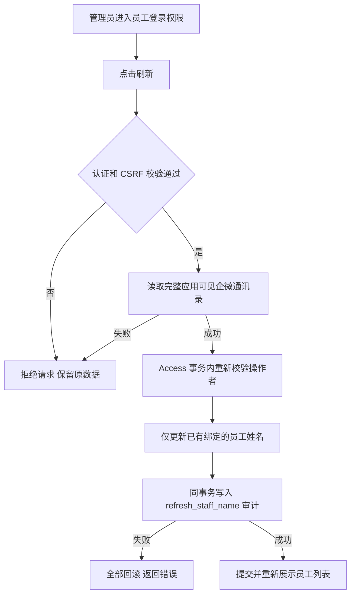
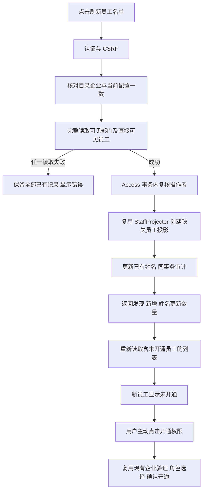

# 员工登录权限刷新失败修复

范围：修复后台访问页面刷新员工姓名返回 500。用户已要求排查并解决；2026-10-12 发布工作台最新人类指令要求本批统一预部署，生产待本批最终授权。

生产证据：应用 SHA `8245526b89d04111acb2b03f66416b9c10d4064e`；真实登录页面点击刷新，`POST /api/admin/access/users/refresh-names` 返回 500 / `internal_error`。当前安装包 `check-enterprise-directory` 返回 complete=true、employee_count=46；生产 `ck_admin_access_audit_action` 缺少代码已使用的 `refresh_staff_name`。这使姓名与审计事务一起回滚。现有纯内存测试未覆盖真实数据库约束。

参考与复用：已检索 [wecom-go-sdk 部门读取实现](https://github.com/go-laoji/wecom-go-sdk/blob/develop/department.go) 和 [wecom-sdk 成员读取 API](https://github.com/dlldsys/wecom-sdk)，均把通讯录读取作为独立 Provider 读取。复用本仓 WeCom Adapter、Access StaffNameWriter、Access Unit of Work 与审计，不改读取方式。官方文档本次网页读取不可用，生产安装包聚合预检直接验证真实 Provider。方案选择新增前向迁移扩展允许动作；复用其他审计动作会歪曲操作含义，去掉审计会失去追踪，因此不采用。

分类：OneID 不涉及客户归属或匹配，已有企微员工绑定继续由 Access 管理；Persistence 为 Provider read + Access 本地事务；External Effects 无 Provider 写入，无新增队列或执行内核；不涉及新增限制。

五项影响：对外接口、错误合同不变，正常刷新恢复成功；机制只扩展 Access 审计动作约束；直接消费者是 RefreshStaffNames → SetStaffDisplayName / AppendAccessAudit → PostgreSQL；页面继续复用 admin_access，Product Design 审核刷新与管理入口，不新增 UI；验证使用真实 PostgreSQL 与真实 HTTP 路由，断言权限/账号数/会话不变、重复刷新不重复审计、拒绝未授权/CSRF 与失败全量回滚。

迁移：Owner Access；保留所有账号、角色、会话和审计，前向兼容旧应用。不回改已发布迁移。生产迁移前按唯一工作台流程备份。回退应用可保留扩展后的约束，不能删已有审计事实。

验收：局部 PostgreSQL 用例先复现约束错误，再应用新增迁移验证成功；最终批次安装包预发验证真实认证刷新接口、员工姓名与审计读回及权限不变。生产仍待用户集中授权，真实员工授权配置由用户选择人员后执行。

## 完整名单刷新相关修复（2026-10-12 晚）

原刷新已解决 500，但仅更新已有账号昵称；ListGovernance 又过滤 access_granted_at=NULL，因此新增未授权员工始终不出现。本轮继承用户“新增员工刷新不到，请原任务解决”的授权，从国内累计 main `fee5cb1947465c2d1ab81f14702542ec2067ca92` 开发。工作台负责与问卷相关修复集中预发和同包生产；原早间 staging-only 限制已由工作台当前明确授权安排替代，开发者仍不自行安装。

真实 Provider 证据：当前生产应用 `83b5e8cb0e858b4f20f9237b10b19e8c9018314e` 的完整预检成功、46 名可见员工；用户给定新员工的 exact user/get 返回已激活、姓名匹配，且出现在可见部门 user/simplelist 中。不能以员工数量仍为46推断未同步，新名单可能与既有 CRM 名单不同。

OneID：仅当前企业受信员工 UserID 与 Access 员工主键，不涉及客户 OneID，不猜测/合并大小写相似账号。持久化：Provider read 在事务外；投影、姓名、Access/平台审计在同一 Access UOW。外部效果：无 Provider 写入，无新增队列；同步按钮沿用有界同步读取。复用 WeComStaffProjector 内核、CreateStaffProjection 与 GrantAccess，不自建员工表或身份系统。新投影 viewer 是内部职工占位角色，login_enabled=false、access_granted_at=NULL，不能登录；页面权限显示“未开通”。目录缺少既有人不删除、不停用、不恢复有效状态。新增企业 scope 核验是防跨企业同 userid 错误归属的最小边界；沿用现有权限/输入上限，其他不新增限制。

前端：Product Design image-to-code 以用户当前员工列表截图和 V4 已挂载 admin_access 为选定参考；复用 admin_base、表格、状态样式、原三步开通权限弹窗。仅新增“未开通”语义/现有开通入口、刷新聚合反馈，无新 UI 框架或页面。canonical `/users/refresh` 提供完整同步，旧 `/refresh-names` 保留兼容并执行同一行为；成功必须在提交后列表重新读回才显示。

五项影响：HTTP 新增完整刷新响应计数，旧入口兼容；Access 增加未授权投影和显示，不授予登录；直接消费者为目录 Port、StaffProjector、Access 列表/开通、原周期 staff reader；页面显示完整已投影名单、未开通状态及授权入口；验证选真实 PG/合成 HTTP Provider、重复/并发、部分失败/审计回滚、同企业/跨企业、权限和唯一超级管理员保留、实际按钮/提示/开通读回。没有新增迁移；应用回退保留未授权投影即可，不删历史员工。

真实新增员工是否可见已独立核实；修复安装后的真实刷新、入库与未开通状态由工作台独立读回，不用合成 Provider 代替生产结果。
