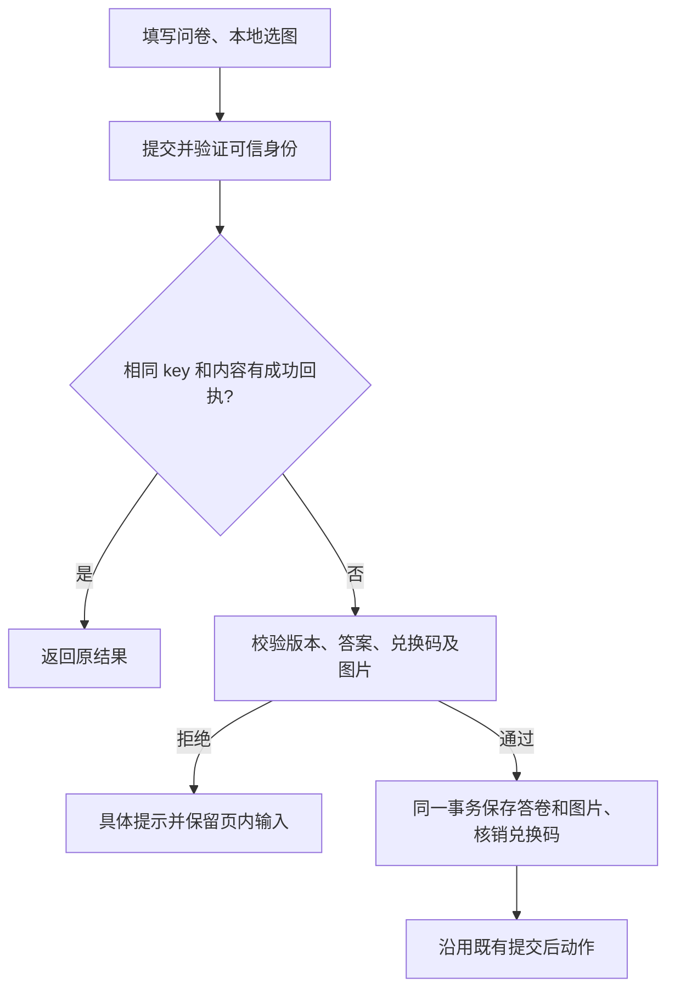

# 问卷兑换码与图片附件：已授权精简 PRD

原任务：01a12dad-c7da-72a0-9173-293fab637ed2。基线：8245526b89d04111acb2b03f66416b9c10d4064e。

## 已确认规则
- 每问卷独立兑换码库，xlsx 首表“兑换码”列，追加导入；跳过空行及重复，不恢复已核销码。
- 一份问卷最多一个兑换码题，固定必填；只有加入该题才验码，复制问卷不复制码库。
- 只在提交时验证并核销；固定空值、无效、已使用提示，拒绝后保留填写状态。
- 附件每字段一张 JPG/JPEG、PNG、GIF，实际大小严格小于 2097152 字节，可配置必填。
- 图片随最终答卷提交，无预上传、临时引用、持久草稿或独立清理任务。刷新/重授权重新选图。
- JSON 提交兼容；带图提交 multipart，前端及该路由预算 120 秒；接收、检查完文件才开启事务。
- 原 key 同内容恢复成功回执；同 key 内容变化明确冲突。核销、答卷、图片、审计、Outbox、外部意图同事务。
- 图片私有读取；码库原码加密，答卷/外推只输出验证或上传标记，不输出原码、图片或私有链接。

## 分类与复用
OneID：沿用 Survey 已验证主体及事务内 Identity Port，不建客、不匹配新身份。
持久化：Survey 拥有码库、核销及答卷附件；Media 私有图片 Port 加入调用方 UoW。
外部效果：沿用既有提交后动作及 outbound；只补新题型序列化，不新增 Provider writer 或执行状态机。
新增约束只来自用户规则、可信身份/字段边界、现有图片安全预算及请求资源承载。
Product Design：已核对现有运营配置截图、编辑器及 H5 入口；复用单壳、表格、题卡与样式，不新建应用或后台中心。

参考：[SurveyJS 延迟上传](https://surveyjs.io/form-library/examples/delayed-file-upload/documentation)、[OWASP 上传建议](https://cheatsheetseries.owasp.org/cheatsheets/File_Upload_Cheat_Sheet.html)。

## 五项影响和验收
合同：新增题型、码库管理、multipart 提交、字段拒绝及私有附件读回。
机制：本地原子核销、图片绑定、内容指纹和原 key 重放；保持原身份/每客户一次提交边界。
关联：Survey、Media、Outbound 序列化、客户答卷展示/导出、HTTP transport 和生成类型。
页面：运营配置码库、编辑器题型、H5 全页/逐题选择预览与错误反馈。
验证：真实 PG 并发抢码/回滚/重放/版本竞争；Excel 保真/坏输入；图片边界、伪造/重复/越界文件；认证读取；真实浏览器业务断言。
技术候选与真实 Provider 验收分开记录。开发范围已授权；生产安装由唯一路由工作台执行。
