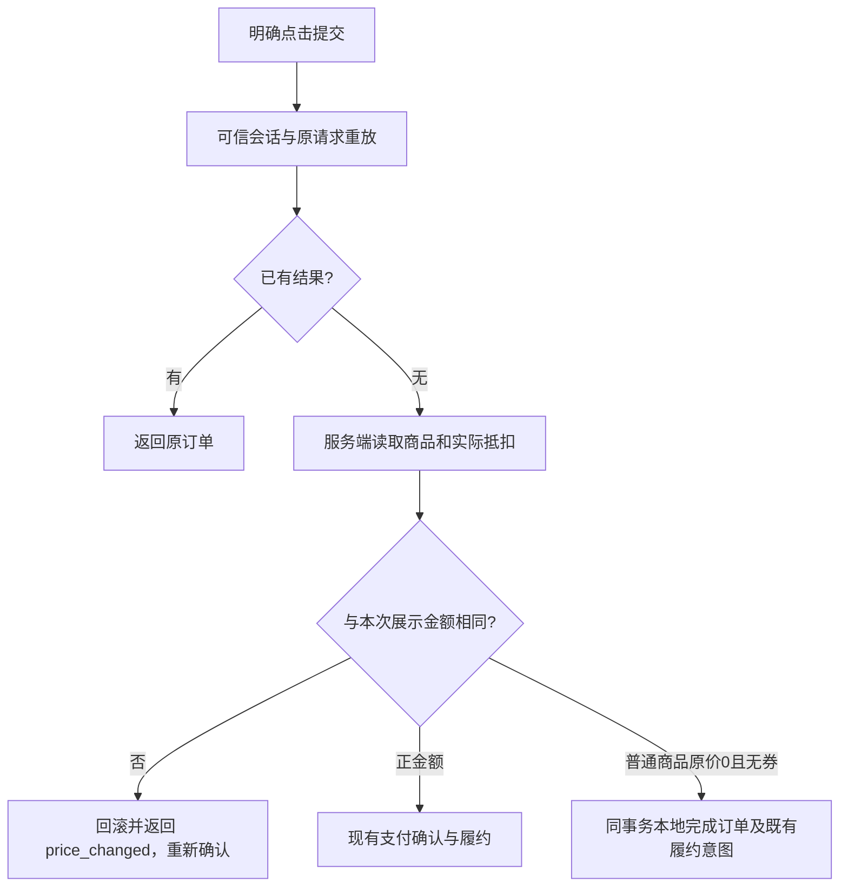

# 零元订单与优惠券最低实付

用户已批准本 brief。业务检查初始基线为国内 main `8245526b89d04111acb2b03f66416b9c10d4064e`；本批候选接续累计源码 `1dbb43b4f716b4ed8b6e5337b3059c5371c01107`，保留已预发的兑换码、员工姓名刷新和问卷私有图片附件成员。两个开发单元共享本文件和一次最终构建/预发，不新建发布路径。

## 业务判断

普通商品原价0且无券可领取；周期商品不允许零元购。两类正价商品用券实际抵扣 `min(券面额, 商品价-1分)`。0/1分商品不占用券。券面额不改，核销整张券且记录实际抵扣，不产生余额。

零元订单形成已购，沿用普通商品不可重复购买的规则。已配置的购买后动作、标签和推送正常接受；付费统计/人群、裂变归因、分销资格和佣金不增加。真实外部接收与本地订单完成分别验收。

## 参考与复用

- [Stripe no-cost orders](https://docs.stripe.com/payments/checkout/no-cost-orders.md?payment-ui=stripe-hosted)：订单完成与 PaymentIntent 分离。
- [WooCommerce checkout](https://github.com/woocommerce/woocommerce/blob/trunk/plugins/woocommerce/includes/class-wc-checkout.php)：根据是否需要付款复用订单完成路径。
- [微信支付 JSAPI 下单](https://pay.wechatpay.cn/doc/v3/merchant/4012791856)：金额必须大于0。
- 复用 V4 Order 的 create 收据、状态/审计/Outbox、标准商品已购锁，Payment 的可信会话和 Checkout 恢复，以及 Product/Outbound 的既有完成事件消费者。无新表、收据操作类型、身份系统、队列、支付 Adapter 或新页面。

## 接口和边界

Checkout 增加可选 `expected_amount_minor`，仅校验差价，省略时保持旧摘要编码。差价发生在支付效果接受前，事务全部回滚。未知结果复用原键和原请求；已完成收据先于当前商品、价格和已购检查。

Order 内部分类增加 `no_payment`，客户端不可指定。零金额仅允许 native 普通商品无券 Checkout；支付/退款/历史订单正金额边界保留。复用 create 收据绑定原会话和请求摘要，保存最终已完成订单。零元响应 `payment_required=false`，支付单/材料/效果为空。状态及购买后跳转只读 Order Port 并核对客户归属。商品下架时，只有已持有该零元订单的认证客户可在原付款页恢复冻结的商品名称与金额；匿名及其他客户仍返回404。旧数字链接保留。会话续期可按同一OneID读取订单，旧请求的变更与重放仍必须使用原会话绑定。

零元结算、完成事件、既有履约意图、会话消耗和收据同一个 PostgreSQL Unit of Work。不调用付款、支付查询、退款和分账。0金额禁止退款状态，修正0<0的已购漏洞。

外部推送保持已有结构，零元支付渠道/交易信息为空，金额0；不增加未知 Provider 枚举或伪造交易。错误和重放沿用 Outbound/EER。

OneID：读取既有可信付款人/受益人及 canonical lineage；不解析或创建新身份。Persistence：现有 PostgreSQL 本地事务。External Effects：复用已有 Product 标签和 Outbound 推送接受，不新增付款效果。必要限制仅为批准范围、差价拒绝及现有身份/金额/重放边界。

## 五项影响和前端

| 判断 | 范围 |
|---|---|
| 对外合同 | Checkout 期待金额、price_changed、payment_required及合法零元结果；正价旧请求兼容 |
| 业务机制 | 券抵扣封顶；免支付本地结算；原事务、收据和OneID复用 |
| 关联模块 | Coupon、Payment、Order及其Product/Outbound/付费统计与人群直接消费者 |
| 页面 | 现有商品结账页、订单中文状态和金额；无新组件 |
| 验证 | 相关具名用例、隔离PG16并发/回滚、实际HTTP和浏览器；真实Provider单列 |

Product Design：已读 index/get-context/现有代码目标及前端一致性流程，preflight完成。保留现有布局、字体和组件。免费领取隐藏券/支付方式，保留商品要求的联系字段；成功显示领取成功/无需支付；差价需重新点击。实施过程中捕获当前页面及修改后同视口，功能与视觉证据分别记录。

## 验收和恢复

金额边界、券核销一致性；0/1分不占券；周期零价拒绝；同键/异键并发、换会话、payload漂移、丢响应后改价/下架、完整回滚、付款/查询/退款/分账调用为0；已购和购买后动作只接受一次；付费消费者不增长；旧摘要、正价及浏览器checkpoint兼容。

从实际diff选择检查到 docs/release-checks.json，不强制全仓。本开发任务负责开发/测试/候选交付，不自行共享环境安装；工作台按当前批次指令逐项更新预发后停留，全部完成且用户明确允许后集中生产。生产迁移前按唯一发布流程备份。恢复先停用相关商品购买入口并前向修复，保留已完成零元订单及履约事实，不盲目回退到无法读取零元的旧应用。
