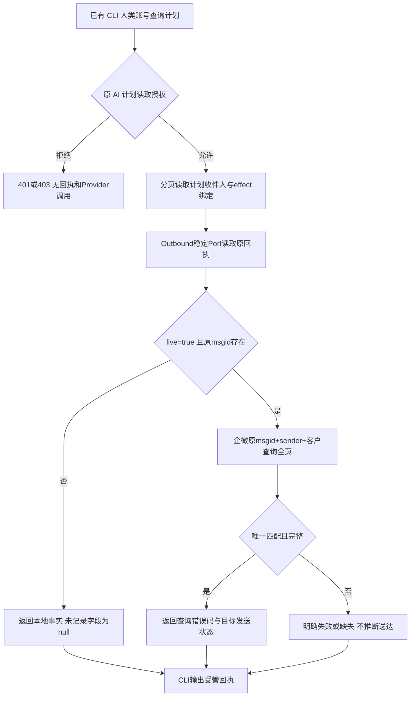

# AI 计划受管执行回执读取

用户已选择保留浅蓝的唯一超级管理员，给黄小璨补齐计划回执读取和 CLI 入口。生产实查黄小璨为 admin；既有计划及 effects 读取成功，全局 ops 错误诊断属于另一个超级管理员入口。角色升级无法补齐尚未暴露的 msgid 与企微发送结果。

参考调研：已检索 GitHub WeChat SDK 的群发查询案例；[EasyWeChat HTTP 客户端](https://github.com/w7corp/easywechat/blob/6.x/docs/src/6.x/client.md) 将 HTTP 元信息与响应载荷分开。复用本仓 PrivateMessageReceipt、GetPrivateMessageSendResult 和原 AI 读取 Authorizer，所有实现依据当前 V4 tree。

新增 GET `/api/admin/ai-assistant/plans/{plan_id}/execution-receipts`，原 cursor/limit 分页，`live=true` 才查询 Provider。输出客户业务ID/显示名、员工ID/显示名、effect本地状态、msgid、sender_userid、创建接口、原创建错误码记录状态、本地发送证据，以及本次查询的HTTP状态、错误码、匹配发送状态/时间。原创建errcode没有留存时保留null；禁止把当前查询0当作历史创建响应。隐藏 external_userid/UnionID、话术、令牌和Secret。

OneID：只读已绑定的canonical customer与原回执；不解析新身份或建客。Persistence：本地只读与Provider read；网络调用发生在应用读取事务完成后。External Effects：无Provider写、重试、对账写入或状态修改；不新增队列或执行内核。回执包含受管Provider账号与任务标识，故复用管理员角色增加receipt.read动作，viewer仍可读原digest-only效果；必要性依据为原回执restricted业务证据边界。复用既有分页与Provider合同。

五项影响：新增只读API/CLI合同；业务机制保持原角色、回执与状态；直接消费者为AI HTTP、Composition Root、WeCom发送结果读取Port及CLI目录；无页面变化；验证授权拒绝、账号可读、秘密隔离、未发送/已发送、查询失败、分页与重复目标拒绝。原超级管理员和两个账号角色不变，测试包括CLI真实TLS旅程和相关PG组合旅程。回退可撤销新增路由，无迁移/数据回滚。

生产验收：用黄小璨账号分别读取计划5、6，查原msgid/账号归属和企微当前状态；没有重新发送。候选由唯一发布工作台按原队列部署，技术安装和真实Provider读取分别记录。
