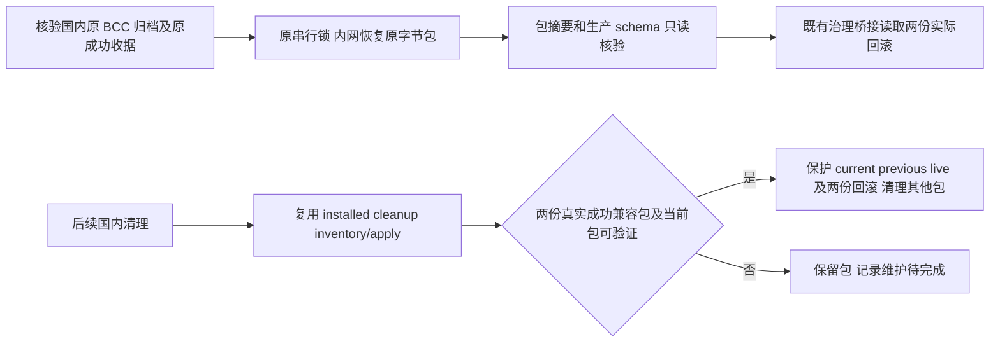

# 国内发布回滚构件保留修复

## 判断与流程

生产 8023435 已安装成功。国内回收只保护 current/previous/实际进程引用，随后治理回收要求两个真实成功且 schema 一致的回滚包；BCC 因前一步被删除而留下缺口。国内预备机的原 BCC 归档仍在，manifest 与原预发、生产安装、真实成功收据一致。

## 参考与复用

参考 [Capistrano deploy cleanup](https://github.com/capistrano/capistrano/blob/master/lib/capistrano/tasks/deploy.rake)：清理只作用于受管发布目录，先保留发布窗口并保护 current。本仓进一步复用现有 `cleanup-releases.py` 的成功顺序、摘要、schema、真实引用、删除前重读与审计，取消 domestic helper 的第二套目录删除判断。保留现有两个回滚的证据门槛；不涉及新增限制。

## 范围

- OneID：不涉及，只有应用构件目录与发布元数据。
- 持久化：既有文件系统发布收据和删除审计；数据库仅只读 schema。无新队列或 durable job。
- 外部效果：不涉及 Provider。仅国内原构件复制及既有元数据桥接，不安装业务应用，不改数据库，不切换流量。
- 对外合同：国内 `--reclaim-obsolete-releases` 继续返回清理结果，缺证据时明确 maintenance-pending，不删除候选包。
- 业务机制：国内清理复用唯一既有治理清理 Owner，历史成功收据不改写、不补造。
- 直接消费者：国内 controller 完成阶段与正常晋级后的治理观察 hook。
- 页面：不修改 UI；治理巡查读取真实回滚数量。

## 检查与验收

执行 `deploy/test_domestic_promote_gc.py`，覆盖两个真实兼容成功包、缺失/伪造/不兼容收据、current 与原游标不一致、实际引用以及不可验证包的拒绝清理。复用 `deploy/test_cleanup_releases.py` 中相关证据拒绝/计划重读合同。Linux 在原 maintenance-check 上执行同一短清单。

运维恢复：保留原 BCC 成功收据；从已核验归档复制到 root 私有临时目录，逐文件核验 manifest/binary/package/schema 摘要，原 production install lock 内原子落位，只刷新既有桥接。验收必须读到 rollback_count=2、两个实际目录存在、真实成功收据未变、生产 current/PID/摘要未变。

固定 helper 修改按原 maintenance-check 与准确字节安装流程推进，仅更新源码/工具。恢复前后不重新安装应用；失败或状态不明只读核对。工具可还原保留的旧 helper 字节；恢复包仅在未被引用时可移出，任何历史收据均保留。

## 实机相关修复

首次 source-only 清理拒绝时，独立只读定位到 Python 动态导入在已封包 deploy 目录生成两个 pyc；包原文件及 manifest 不变。修复导入前禁止字节码写入，并以真实模块加载断言目录没有新文件；保留当前进程和原构件字节。仅删除与本次导入对应且摘要已独立核对的两个缓存文件。后续候选只重跑受影响的 GC 八项合同，原清理 Owner 二十项 Linux 结果未变继续复用。
