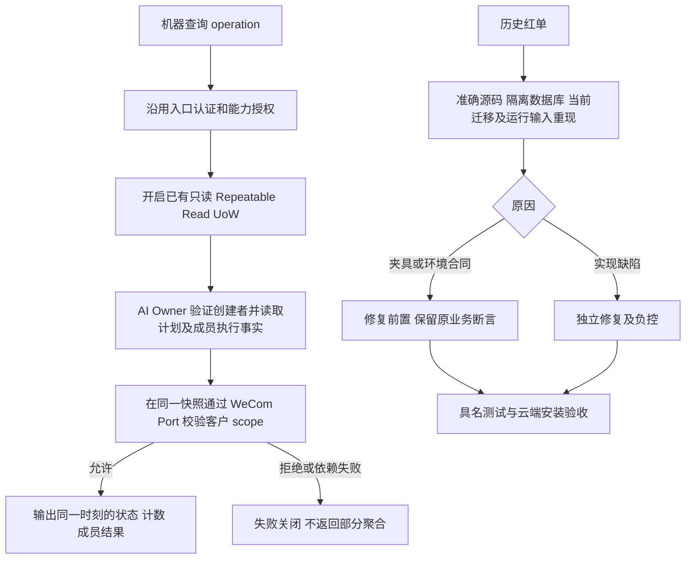

# 体检第二批：聚合一致性与测试基线

用户已授权修复、针对性及对抗性测试和云端预部署，明确禁止本批晋升生产。基线为唯一工作台累计源码 37330df426e4c5eec23c0c4e45de175002dd2af7；原体检报告及失败收据保持原样。

## 决策与复用

- OneID：只读取已有 canonical customer ID 与 Owner scope，不解析新身份、不建客、不合并。
- Persistence：只读跨 Owner 报告复用 `NewReadOnlyRepeatableReadUnitOfWork`；AI 新增事务内聚合读取 Port，明确拒绝无事务。默认命令 UoW 不变，禁止嵌套 UoW。
- External Effects：只展示已保存的执行事实；不触发 Provider、不创建队列或第二套执行状态机。
- 不涉及新增业务限制。保留原认证、创建者隔离、scope 默认拒绝和现有 Provider 时间语义。
- 无 UI 编码。机器接口字段及状态语义保持兼容，消除混合时刻响应。

## 参考

[PostgreSQL 16 SET TRANSACTION](https://www.postgresql.org/docs/16/sql-set-transaction.html) 说明 Read Committed 每条命令更换快照，而 Repeatable Read 可保留事务快照；因此仅合并为默认事务仍不充分。
[GitHub testfixtures](https://github.com/go-testfixtures/testfixtures) 展示真实数据库隔离夹具模式。本仓已具备隔离 schema/数据库和当前 migration 模板，直接复用，不增加依赖。

## 候选与验收

R04 独立行为提交：稳定 Port + Composition 只读快照 + Owner Adapter 复用事务。验证完成与读取交错、scope 在查询期间及下一查询变化、跨机器拒绝、依赖失败不返回部分数据、无事务拒绝、只读无业务写入。云端在准确安装包运行受影响合同。

R05 按明确缺陷分提交：当前消费者迁移补齐、签名退款载荷/发生时间负控、未知恢复 failpoint 解除、安装层入口与输入明确、其他红单逐个归因修复。无匹配/skip/缺环境不记通过；保留原失败证据。具名清单随源码提交，局部结果不称全量回归。

五项影响：对外合同兼容；业务机制仅聚合读取事务边界；直接模块 AI/OpenPlatform/WeCom 与受影响测试消费者；页面无修改；证据为具名 PG/并发/拒绝合同与预发安装收据。测试候选无应用载荷时仅推进源码。

回退：R04 可恢复原读取实现，未增加数据迁移或修改持久业务事实；测试修复保留历史红单与当前收据。仅唯一工作台沿用原队列/锁/attempt 构建和预部署；生产授权为 false。
