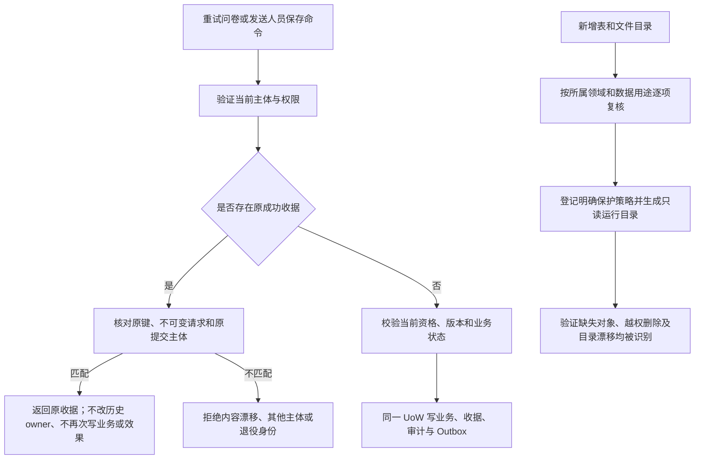

# 体检前三项修复与预部署

用户已授权逐项修复体检 R01–R03、针对性和对抗性验证、云端预部署；本批禁止生产晋升。基线为国内 main `c97ddb05a2038c04264201b8eb476592d107fb04`，复用 2026-10-13 体检和 SOL61 的成功键合同。

## 业务判断流程

## 参考和复用判断

- [Stripe 幂等请求](https://docs.stripe.com/api/idempotent_requests)：保存原请求结果、参数不同拒绝。复用 Segment 的既有 operation/actor/key 收据，不新增执行内核。
- [OWASP 授权指南](https://cheatsheetseries.owasp.org/cheatsheets/Authorization_Cheat_Sheet.html)：每次重放仍验证当前授权。问卷复用 Identity 的可信 subject 与同事务锁，不以请求键代替身份。
- 问卷可用“删除 lineage 检查”“证据摘要匹配”“持久化 Identity-owned handle”三种方法；采用第三种。它只恢复同一活跃原提交者的精确收据，旧无 handle 行保留原 lineage 边界，不猜测补写。结果查询继续按当前 lineage 授权。
- 发送人员可冻结目录版本、放宽摘要冲突或摘要仅绑定用户命令；采用第三种。首次接受才冻结资格快照。旧收据仅在冻结快照和当前可信员工映射足以证明原命令时恢复，不能证明时拒绝，不改写旧收据。
- 保留登记采用已审查领域的业务事实/收据/文件保护；不从名称推断可删，不启用新增 TTL 或清理任务。

## 分类、范围及五项影响

| 候选 | 对外合同与业务机制 | 直接模块和页面 | 验证 |
| --- | --- | --- | --- |
| R01 | 同一活跃 OAuth handle 在 merge/revert 后恢复原成功键；保留历史 owner，新增可空私有 handle 字段，无猜测 backfill | Survey Submit/store、Identity subject Port、问卷重试；无 UI 编码 | 真实 PG merge/revert、原键并发、漂移、换 actor、退役 handle、旧行拒绝、码消费/审计/Outbox 不重复、迁移保留 |
| R02 | 摘要绑定 actor/package/expected version/有序 Provider references；资格刷新或停用后仅恢复已成功命令，新键仍校验资格 | Segment execution/receipts、Access 本地目录 Port、后台保存；无 UI 编码 | 原结果重放、目录故障/漂移、旧收据兼容、并发、CAS、actor/key/payload 隔离、事务回滚和 HTTP 权限 |
| R03 | 补齐 18 张表与 invoice-materials 路径的 Owner、理由和保护政策；运行只读目录同源 | 治理登记、AdminOps 覆盖读取、所属领域；无 UI 编码 | 注册覆盖与投影一致、未知对象拒绝、恶意清理绑定拒绝、财务/私有材料不进入通用删除 |

OneID：R01 使用 `VerifiedIdentitySubjectReader`/写锁 Port；不匹配外部身份、不建客、不合并。R02 只用 Access 员工主键，不涉及客户 OneID。R03 不改身份，只登记已有身份相关事实的保留。

Persistence：R01/R02 为领域本地 PostgreSQL UoW；业务、原收据、审计及 Outbox 原子提交。R03 为元数据和嵌入只读目录。External Effects：保留既有受理边界，重放不创建新意图，不调用真实 Provider。没有新队列、Worker、lease、重试或对账状态机。不涉及新增限制，复用现有权限和输入边界。

## 验收、迁移和交付

- 三项各以独立提交交付实现和测试；AI 清单覆盖改动及直接消费者，局部通过不称全仓回归。
- 问卷前向兼容加列，旧数据原样保留；旧行缺少可信 handle 时不能越过当前 lineage。应用回退不得移除该列或改写成功收据。
- 没有新增物理清理行为；原有保留历史及收据不可被此登记删除。
- 国内准确候选推送后重新读取唯一路由，交付完整 base/head/tree/ref 与测试收据。工作台使用既有队列、锁和构建路径统一预部署并独立读回；本批授权只到预部署，不得继承其他任务的生产授权。
- 云端 Linux/安装包合成旅程和真实用户/Provider 观察分列。实际扫码、真实外部送达及生产业务验收不在本批完成范围。
