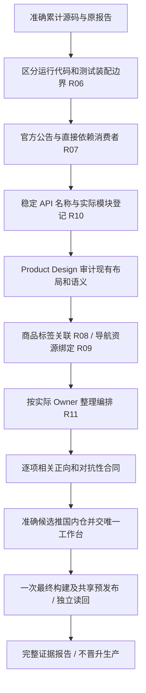

# 体检剩余修复父 PRD（R06–R11）

复用已授权的全系统体检 brief 和 R01–R05 行为合同。累计基线 c5e92ee90012873504994a73e3252363acdeea5a。用户通过唯一发布工作台授权本原任务按 R06/R07/R10 → R08/R09 → R11 续做；只预发布，不晋升生产，沿原队列、锁及 attempt。

| 项目 | 用户可观察结果及验收 | 分类与边界 |
|---|---|---|
| R06 | 测试装配不误报；真实运行跨域、平台反向依赖、非法 verified 构造及环境读取仍被拒绝；恢复入口 operator 由平台配置注入 | 不增 OneID 行为；沿用 Access 原事务、授权、CAS 与审计；无任务或 Provider 写入 |
| R07 | source-map-js、x/image 按官方修复范围最小更新；DOM/CSS、图像、二维码、字体、海报及表格消费者通过 | 依赖更新；无身份/数据迁移/任务/新增外部效果；开发风险、模块匹配与符号可达性分列 |
| R10 | 每个当前 API 操作有唯一稳定 operationId；实际模块有 Owner、入口、数据、状态和验证边界 | 源码登记，不新增机器权限、路由或数据库表；聚合占位不能替代真实模块 |
| R08 | 标签可访问名称、点击聚焦、键盘输入和错误定位正确，保持版式和保存语义 | V4 Host 已有商品 UI；无身份/任务/Provider 新能力；编码前 Product Design |
| R09 | 当前导航每个直接图标 URL 可加载，保持菜单顺序和权限 | 现有资源显式绑定，无数据或效果变更；编码前 Product Design |
| R11 | 清晰职责从装配层移回 Owner，行为合同与拒绝规则不变 | 按实际代码选择最小闭合职责；不按行数拆分、不新增跨域具体依赖或独立任务状态机 |

## 参考与复用决定

- [Go 官方测试组织](https://go.dev/doc/code#Testing)：测试装配是 `_test.go` 编译边界；不向运行包开放免检通道。
- [source-map-js 官方公告](https://github.com/advisories/GHSA-68fv-2mgg-jv7q)：以明确修复版本 1.2.2 校准最小更新。
- [Go 官方漏洞工具](https://go.dev/doc/security/vuln/)：模块、包和符号可达性分别记录；openpgp 不因模块告警盲目改写支付密码学。
- [OpenAPI operationId 规范](https://spec.openapis.org/oas/v3.1.0.html#operation-object)：稳定且全局唯一，沿用现有命名。
- [W3C 表单标签](https://www.w3.org/WAI/tutorials/forms/labels/)：显式关联现有可见标签；复用现有 Host 和图标库。

## 交付与限制

前端复用记录：当前 `/admin/productForm.html` → Product adapter → `webshell.RenderProducts` → `admin_base`/Product Host → 当前 V4 模板绑定。2026-10-13 Product Design audit 已运行保存上下文 preflight、检查实际只读回环页面并保存/重新打开修复前截图；DOM 复现六字段缺 labels 及三导航图标加载失败。沿用原页面版式，扩展共享 formLabels 并显式绑定既有导航资源。截图只证明界面与语义，不替代真实授权保存、Provider 或安装证据。

每项缺陷一个完整提交，相关测试同提交。更新准确 diff 的 release-checks 清单，执行具名相关检查和拒绝合同；skip、缺环境、无匹配不算通过。源代码/工具登记与应用安装分列。全部完成后交工作台统一预发布，本任务不自行安装共享环境。R12 目标机器容量、真实 Provider、真实支付和自然业务观察独立未验；本批不新增生产授权。
