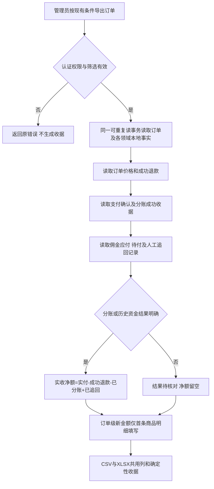

# 订单导出分账对账优化

用户授权：优化订单导出，单列应收、实收及分出去的金额；本任务仅开发、检查和交付国内候选，未获生产部署授权。
准确基线：唯一工作台在前序小店接受后给出的累计源码 `aa2585c63939c9eff88099750c94326051f69703`（tree `78f8072936311186c19513658cec4f2c3e352ce9`，国内 `refs/heads/codex/wechat-shop-buyer-staging-v6`）；独立分支 `codex/order-export-sharing-v2-20261013`。原候选96d8235基于c97，仅作先前本机收据，不作为本次发布基线。

## 业务判断流程

## 调研与复用

- [微信支付查询分账结果](https://pay.wechatpay.cn/doc/v3/partner/4012467002)：接收方 SUCCESS 才是成功终态；受理与处理中不能当成已支付金额。
- [Stripe Balance summary](https://docs.stripe.com/reports/balance)：逐项区分 gross、fee、net，并声明时间和金额口径。借鉴金额拆列及净额明确说明，不引入其 API。
- 当前 V4 `internal/order/app/export.go` 固定 27 列、每商品一行，订单金额在各明细重复；`cmd/aicrm/order_export_adapter.go` 已在 Order 事务中使用 Payment/Distribution/Identity/Customer 稳定读取 Port。
- 复用 Payment 自有分账指令的成功/未知标记和 Distribution 的佣金及人工追回事实，不读跨领域表、不触发支付/分账/查询 Provider。

## 行为合同

原 27 列、筛选、权限、文件名、导出上限及原字段语义保留；末尾追加 9 列：

| 列 | 口径 |
|---|---|
| 订单应收金额 | 下单冻结的优惠后应付金额 |
| 买家实付金额 | 本地确认支付金额；未支付 0；历史/小店以现有可信订单支付状态保留金额 |
| 应分账金额 | 当前佣金应付总额，不从当前配置倒推历史比例 |
| 已分账金额 | Payment 指令已付且接收方成功、结果明确的总额 |
| 待分账金额 | 活跃佣金 max(当前应付-已付,0)；取消/零佣金不计 |
| 分账追回金额 | Distribution 中人工追回记录；商家承担不算追回 |
| 商家应收净额（未扣手续费） | 订单应收-成功退款-应分账 |
| 商家实收净额（未扣手续费） | 买家实付-成功退款-已分账+已追回；未知时留空 |
| 分账状态 | 无分账/待分账/处理中/已分账/部分分账/异常待核对/结果待确认/历史或渠道分账未知 |

新金额只填排序后首条商品明细，后续明细为空，整列求和不会重复；旧金额列语义兼容。退款后尚未追回已付佣金可出现负净额，保留真实缺口，不截成零。历史/微信小店缺少本地分账事实时已分账与实收净额留空，不冒称零分账。原生微信支付已付但无支付确认事实时，实付和实收留空并标待核对。历史/渠道缺少分账数据时，应分账、待分账、追回和商家应收净额同样留空，避免未知当作零。读失败仍整次失败，不下载缺失报表。

## Product Design

使用 product-design:index → user-context preflight → audit。内置浏览器被登录墙阻挡，改用已有 Chrome 登录。当前订单导出入口截图 `/private/tmp/order-export-sharing-audit/01-export-entry.png` 已保存并打开检查。
1. 订单列表→导出入口：可用，原组件和筛选完整；列表只显示金额及佣金归因，导出入口未说明净额口径。
2. 下载内容：现有代码确认仅 27 列，实际线上文件本次未下载，不能声称已完成新导出线上验收。
复用 `orderAdapter.ts` 现有按钮、反馈和订单壳，在导出入口下加一条口径说明；不重设计页面。截图低对比说明文本提示需沿用已有语义结构，不据此声称完整无障碍合规。

## 架构分类与五项影响

- OneID：仅复用既有 canonical customer 展示读取，无身份解析/新建/归属更改。
- Persistence：既有只读快照＋导出审计收据同一 PostgreSQL UoW，无迁移/新业务状态/任务。
- External Effects：只读本地已确认收据，不发起 Provider 调用或新效果；不涉及新增限制。
- 对外合同：CSV/XLSX追加 9 列及表内金额口径说明页；导出 schema 更新，旧列保留。
- 业务机制：本地资金事实投影，无结算写入改变。
- 关联模块：Order 导出、Composition bridge、Payment 读取 Port/store、现有 Distribution owner read。
- 页面：订单导出入口文案，既有组件样式复用。
- 验证：具名导出单元、真实 PG 认证 HTTP/CLI/XLSX/CSV 及前端 adapter；局部回归。

## 验收、风险与回退

覆盖无分账、未支付、应付未结、成功、处理中/失败/未知、退款后佣金未追回及追回、多商品金额求和、历史未知、公式文本、CSV/XLSX一致和回放确定性。测试只用隔离本地合成数据。真实场景：分别导出普通订单、已分账分销订单、退款订单，比对订单支付/退款、分账接收方成功记录及微信账单；逐列求和应与每单汇总一致。手续费/渠道结算时间仍需支付账单，此输出不承诺等于银行实际到账。

风险：新增列影响固定列数消费者；原列不变，直接消费者合同同步更新。回退为上一完整包，无数据库迁移；不删历史收据，不改分账状态。工作台完成预发及技术发布后再记录真实 Provider/财务验收。

## 本次验证收据

环境：macOS arm64 / Go 原生缓存 / PostgreSQL 16.13 / Node 24.21.0、npm 11.19.0。Node/npm 与正式锁定版本不同，正式 Linux/固定工具链及最终应用构建由工作台执行。

- `go test ./internal/order/app -run '^TestExport' -count=1 -v`：8 个顶层用例通过，包括15类财务状态、多商品首行计账、负金额数值类型、CSV公式保护、现有完整字段、优惠和退款、确定性回放、空结果、数量/字节上限及读取失败。
- `go test ./internal/order/http -run '^(TestExportRequiresAdminCSRFAndRejectsUnresolvedIdentityFilters|TestExportReturnsReceiptBackedCSV|TestExportSharesIdentityResolutionAndXLSXDefault|TestWechatExportCompatibilityStaysScopedAndSharesFormats)$' -count=1 -v`：4 个顶层合同通过。
- `go test ./cmd/aicrm -run '^TestOrderExportCommissionUsesCurrentPayableAndRecordedRecovery$'`：佣金聚合通过，人工追回与商家承担区别、取消/零佣金和调度警告过滤。
- `AICRM_DATABASE_URL=<loopback dedicated aicrm_test_order_export_20261013> go test ./cmd/aicrm -run '^TestPostgreSQLUnifiedOrderExportHTTPAndCLI$' -count=1 -v`：通过。真实认证 HTTP、CSRF、CSV/XLSX、CLI文件权限、支付所属 Port、两个成功分账合计3.09元、失败/取消不累计、已记录追回0.03元而商家承担0.07元不计追回；应收净额26.94元/实收净额26.87元。六种处理中/未知/明确异常/取消组合通过。解密失败503，无成功收据。
- `node web/v3/orderAdapter.test.mjs`：10 组相关页面旅程通过，新增提示及 aria-describedby、筛选、下载状态/错误/空结果、现有退款和外部历史逻辑。
- `node scripts/prepare-donor-source-views.mjs`：当前V4树231 bindings、230视图机械还原。初次编译及前端测试因缺少这些生成资源未执行，准备后通过。首次PG新增夹具不符合 paid_minor 的既有状态约束，已改为合法售后 exception 并重跑该用例通过；没有修改数据库约束。

以上仅局部检查，不是全量回归。未安装共享预发/生产，未做真实支付/扫码/分账Provider或实际银行账单核对。

### 工作台预发收据名 order-export-sharing

最终同包预发安装后，用既有隔离合成订单/管理员认证入口检查 `/admin/orders` 导出提示及 XLSX：36列、原27列顺序不变、金额口径页可读；选择已支付分销、未支付、退款后已分账、未知结果和多商品订单。检查应分账与已分账分离、实收公式、未知留空、新金额每单只计一次、CSV/XLSX相同金额。复用原队列/锁/attempt和stage-evidence，以此名称记既有收据；该预发检查当前尚未执行。

## 安装合同补齐（原范围，复用父 PRD）

工作台复核指出原 `TestPostgreSQLUnifiedOrderExportHTTPAndCLI` 是源码 composition/httptest 证据，不能作为实际安装包验收。此补充仅完善原导出能力的验证，不改变产品代码、数据口径、身份/权限政策、数据库迁移或 Provider 边界；原 Product Design 和业务流程继续复用。

- 新入口 `TestPostgreSQLOrderExportSharingInstalled` 必须传入既有 `InstalledProduct` 的绝对包目录、二进制、SHA 和完整 SHA256，缺参失败，不跳过或回退源码 handler。复用 `validateOrdersOAuthInstalledProduct`、`startPeriodicContactInstalledProcess`、`waitInstalledSurveyReady` 以及现有 HTTPS proxy 和 Access 具名登录夹具。
- 同一订单 fixture 只负责准备和独立读回隔离 PG；所有安装模式验收请求都走 HTTPS→proxy→指定二进制。通过代理读 `/readyz` 核对 SHA，读取真实 `/admin/orders` 与其 Host，并逐字节比较指定包资源，留下 Host SHA256。Source composition 不承接安装 HTTP。
- 实际安装模式覆盖登录、匿名401、缺CSRF403、既有 Access operator 夹具 viewer 角色403、preview、完整 XLSX、原27列顺序与新增9列、金额口径页、无联系方式留空、4单5明细新金额首行计账、CSV、重放相同字节、CLI受保护0600文件、六种分账状态、读取解密失败503且无多余收据。只启动 API，无 worker/真 Provider，独立断言 `external_effect_attempts=0`。不另造凭据/session签发框架，owner沿用原导出fixture，viewer沿用Access已有operator fixture与AddUser正常入口。
- 预发执行：`bash scripts/run-installed-order-export.sh --binary <最终同包二进制> --root <最终包目录> --sha <最终应用SHA> --binary-sha256 <完整摘要>`，使用既有隔离回环测试数据库和原 stage-evidence 的 `order-export-sharing` 收据名。
- 本机诊断结果：实际本地临时二进制＋同包Host模式通过，runtime源SHA `96d82354b06802c7350bd9d9e9b2ded4ebbffddc`、binary SHA256 `196e99d9b3634f8de8750aa034758a62a79508ae4bfecd6e3e091a206fc2ecb0`、Host SHA256 `feb6a75d49c6bdbb4f56cd13d9a241aae03f70493901e8bdfb5d414ecd3bc858`。完整日志 `/private/tmp/order-export-installed-diagnostic/installed-contract.jsonl`。这只是 macOS 本地合同诊断，不是最终累计 Linux 包或共享预发安装证据。
- 夹具修复：首次多明细使用零价赠品被现有“零价原生条目只允许本地无支付订单”合同拒绝，改用 Owner 正常 Create 创建两条正价商品订单；首次子进程启动拒绝源码夹具短 webhook secret，改为仅测试的合法长值，没有放宽任何产品约束。各次失败仅重跑受影响合同。
- 当前已核实工作台用户最新指令：按小店→订单导出→裂变UI顺序处理，全部完成预发布后再集中正式上线，先不晋升生产。工作台将给出前序小店接受后的唯一准确累计 base，本任务在此之前不按旧 base 重推候选、不安装共享环境/生产。

准确基线衔接：工作台已核实前序小店为第22成员接受、in_flight为空，指派base aa2585c63939c9eff88099750c94326051f69703。保留该base全部健康/小店累积源码，仅移植本项原能力96d8235及安装合同c509a45；检查清单冲突采用本成员原15项并绑定新base，既有成员的门禁/安装收据继续由原批次保留。共享orderAdapter测试自动合并后覆盖其完整直接合同。Linux和最终同包预发仍由唯一工作台执行，暂不晋升生产。

### 新累计基线验证

- 在base `aa2585c63939c9eff88099750c94326051f69703` 上完成原能力和安装合同衔接，仅16个本项路径变化，前序健康/小店源码保留。
- 当前准确树的 `TestPostgreSQLUnifiedOrderExportHTTPAndCLI` 与 `TestOrderExportCommissionUsesCurrentPayableAndRecordedRecovery` 重新执行通过；共4订单、5明细，认证/CSRF/只读viewer拒绝以及上述完整导出断言均通过。日志 `/private/tmp/order-export-installed-diagnostic/rebased-source-contracts.jsonl`。
- 当前 `node web/v3/orderAdapter.test.mjs` 11组通过，包括前序小店昵称、联系方式掩码和晚到OneID展示，以及本项导出提示/全部原订单消费者。日志 `/private/tmp/order-export-installed-diagnostic/rebased-order-adapter.log`。
- Order导出8项单元、HTTP导出4项合同的直接业务输入/函数保持不变，复用原收据；新源码PG旅程已完成当前Composition/Access/各Owner读取组合和编译。安装合同本机诊断包仍是原runtime源码96d8235，不据此宣称新的候选head/最终Linux包安装验收。
- 生成资源恢复：跨基线后旧派生OpenAPI和materialization收据被V4工具拒绝；保留旧字节，再调用已有 `cleanStaleMaterialization` 逐个核验旧收据、只清理230个未跟踪生成视图，随后prepare核对231 bindings并重建当前230视图。没有修改canonical OpenAPI、锁文件、内容库、工具政策或业务源码。
- 当前所选检查仍为本成员原15项。最终工作台用新安装入口完成原 `order-export-sharing` 收据，保持小店→本项→裂变UI的原顺序和唯一批次；未预发或晋升生产。
