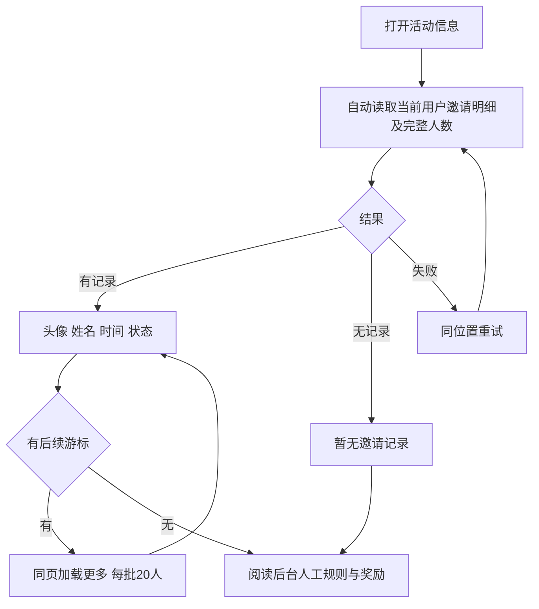

# 裂变活动详情与完整名单读取

用户于 2026-10-13 确认 Creative Production 第二版图稿、完整人数及每批 20 人的加载方案，并授权完成后交给当前发布工作台正常上线。复用本会话已完成的市场参考、业务判断和父 brief；本文件记录最终实施合同。

## 行为与设计

浏览器标题删除 AI-CRM 后缀，页面内删除重复活动大标题。活动信息页只保留返回榜单、邀请明细、后台人工配置的规则与奖励。删除参加状态卡、该卡倒计时、查看明细入口及预设规则列表；榜单主页面的参加/接受邀请仍从既有主操作进入。

标题行右上角显示完整名单“共 N 人”，包含保留在明细里的已撤销记录。有效邀请数、排名和计分保持原业务合同。名单进入时自动读取，每批 20 人同页续读；在途请求防连点，失败保留已读记录并重试原位置，旧轮次响应不覆盖当前页面，按服务端稳定行键去重，追加时保留滚动位置。重开信息页读取最新名单。

头像使用现有 Provider 图片和既有缺图回退，固定 46px 占位，与文字间距 12px。长姓名和时间可换行。后台奖励说明保留换行，空内容隐藏卡片。参考 [Vant Cell](https://vant-ui.github.io/vant/#/en-US/cell)，复用 V4 H5、referral.css 和既有参与流程，不引入第二 UI 框架。

## 数据与五项影响

- OneID：只读现有授权客户，复用 Identity Port 和 canonical reporting；不改身份解析、建客或合并。
- 持久化：无新表或迁移；内部读查询继续使用既有 PostgreSQL Unit of Work。
- 外部效果：无 Provider 写、支付、退款、消息或新持久任务。
- 对外合同：邀请响应添加 total_count、非敏感 entry_key；续读改为绑定当前用户和活动的加密游标。标题 HTML 和信息页展示更新。
- 业务机制：完整人数和成员边界在同一查询读取；以不可变来源水位及排序位置续读。新邀请下一轮刷新出现，退款只更新保留行的状态。人数按规范客户去重并保留自购排除。
- 关联模块：referral app/store/port/http、既有 H5、页面构建入口、直接消费该信息页的既有 Chromium journey。
- 验证证据：具名 PostgreSQL 用例、HTTP/store 整包、两个前端合同、四个真实 IAB 视口、并排视觉 QA。最终安装包 journey 由发布工作台沿既有 referral-poster 收据执行。

限制判断：20 为读取批量，允许继续读取全部名单；防重复在途请求保护分页正确性。复用既有授权和分页资源边界，无新增活动人数限制或审批。

## 验收与发布

已覆盖 0/3/20/21/30/40/41/50/100 人、连点、失败重试、迟到响应、重复响应、同名、恶意姓名、非法日期、空规则、未参加权限，及真实 PG 百人续读、并发新增、撤销保留、规范身份、自购排除、跨身份/活动游标拒绝。

真实 IAB 已检查 320/375/390/430px 宽度，百人名单初始 20 行且显示共 100 人，320px 下最终加载 100 行；无横向溢出或头像文字重叠、无控制台警告/错误。局部验证不称全仓回归。真人微信环境和最终安装包读回分别记录。

发布工作台执行原队列、相关 Linux 检查、最终国内构建及预发、已有本范围授权的同包晋级和独立读回。开发任务只推候选与交付，不安装共享预发或生产，不改变其他批次顺序与授权。无数据库迁移；撤回只涉及本次应用展示与读取行为。
