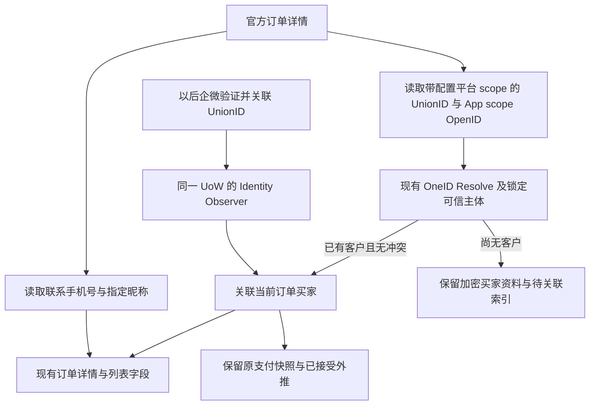

# 微信小店买家资料与 OneID 修复

复用已授权微信小店父 PRD。本次按唯一工作台回告对齐累计源码 base 为 37330df426e4c5eec23c0c4e45de175002dd2af7；生产排查版本 8023435693fca28e4d8ef03a18031747dcc2294c。原任务 01a1291c-c9d4-7be3-aac6-037536644d66。

## 复现与判断

源单 3739797044778671872 已于 10月13日03:00 入库为 CRM 5655，但付款客户为空，保存的外推 Phone/Account 为空。官方详情确实返回 `order.unionid` 和 `delivery_info.address_info.virtual_order_tel_number`；UnionID 值与用户编号 1023798 的企微已验证身份一致。当前 Adapter 只读取 OpenID 和 recharge_info，漏掉上述字段。用户确认小店与企微使用同一开放平台 wx0ca836834b18e989。

用户明确指定买家展示昵称采用 `source_infos[].account_nickname`，按该业务映射实现；昵称仅用于展示，不参与身份匹配、不改客户档案姓名。手机号是订单联系事实，不升级为已验证手机号。

## 边界和最小实现

- OneID：使用 Provider 内部构造的 VerifiedFact、配置中已确认的开放平台 scope、现有 Resolver / SubjectReader。Resolve 不建客；身份冲突不自动合并，也不按手机号或昵称猜归属。已由管理员确认的 OneID 合并按锁定的 canonical lineage 归一当前买家，保留原支付和外推事实。
- 持久化：Order 只写自己拥有的订单与小店资料；Phone、昵称和外部身份原值加密。待关联索引只保存 scope 与摘要。Identity 通过稳定 Port / composition bridge 在原 UoW 内通知 Order，关联、审计与 Outbox 同事务，不新增队列或轮询。
- 外部效果：仅纠正新订单的输入字段。历史已接受/未知结果的意图、支付快照、效果键和冻结发送体保留，不因资料回填再次开通。未关联客户、缺手机号/账号仍按原已确认规则发送，不新增完整性门槛。
- `virtual_order_tel_number` 为虚拟发货联系字段；保留为订单联系资料并脱敏展示，不用号码建立 verified 身份。
- 关联既支持客户已存在后订单到达，也支持先订单后企微。复用 Identity 当前身份键锁，避免首次订单与企微同时到达时漏关联；后续响应省略可选资料时保留已读取内容。既有旧单通过现有指定窗口读取补齐资料，不修改日常频率。
- 管理端继续用现有 `payer_name`、`payer_customer_number`、`payer_phone_masked` 和联系层级展示；小店手机号可在未关联时脱敏显示，指定 account_nickname 优先用于买家显示。原生订单行为不变。

## 成熟参考与页面

复用 WxJava 微信小店模块的 [订单 UnionID](https://github.com/binarywang/WxJava/blob/develop/weixin-java-store/src/main/java/com/binarywang/wxjava/store/bean/order/OrderInfo.java)、[虚拟发货联系方式](https://github.com/binarywang/WxJava/blob/develop/weixin-java-store/src/main/java/com/binarywang/wxjava/store/bean/order/OrderAddressInfo.java)、[来源昵称字段](https://github.com/binarywang/WxJava/blob/develop/weixin-java-store/src/main/java/com/binarywang/wxjava/store/bean/order/OrderSourceInfo.java)。不增加 SDK 运行时。

Product Design 已读取 index / audit / image-to-code、完成 user-context preflight；无已登记参考条目。使用用户本次订单截图作为视觉目标，复用现有订单详情布局和字段。截图保存在仓外 /tmp/aicrm-shop-buyer-20261013/01-reference-order.png，已打开检查；不增加视觉资产、页面框架或布局。

## 验证与交付

具名用例覆盖真实字段合同、手机号与昵称映射、缺资料正常入库、同 scope UnionID 关联、跨 scope / 跨根冲突拒绝、先企微后订单、先订单后企微、并发/重放和事务回滚；补资料后付款快照与已接受效果/发送体不变。HTTP / 浏览器确认现有买家栏、用户编号、脱敏手机号和原生订单展示。

五项影响：合同为现有订单字段补齐；机制为加密小店资料和 OneID 关联；直接模块为 Payment Adapter、Order、Identity 与 composition；页面为现有订单列表/详情数据；证据为 Provider 合同、真实 PG 两种先后顺序、拒绝/并发/回滚及浏览器读回。新增限制仅复用已有 scope、身份冲突、加密及效果幂等边界。

开发完成后实际推送国内准确 ref，按路由交给现有发布工作台；生产迁移前按现有流程备份。独立读回此源单与客户关联、昵称、脱敏手机号；关联前后原外推意图 300 和效果数量/发送体摘要保持一致，接收方实际开通另行核对。

## 当前串行发布边界

工作台已有 R01 的 `0244_survey_submission_subject.sql` 在预发应用；本次使用独立前向迁移 `0245_wechat_shop_buyer_details.sql`，保留已应用迁移的名称和 checksum。当前祖先 R01/R02/R03 仅获预发授权，本次小店授权只覆盖相关缺陷，不覆盖祖先能力；工作台继续原队列分别保留授权范围，生产安装与目标补拉以其满足对应授权为准。
