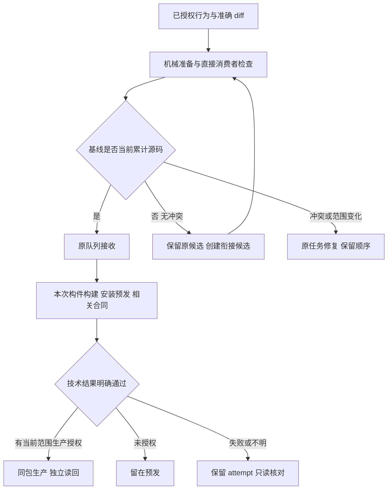

# 开发与发布优化

本任务复用用户已批准的方案：优化 skill 和原工具，工作台自动衔接无冲突旧基线，批次内通知有开发授权的原任务。随后将完整 main 上传 GitHub，校验全新 clone，再清理本机旧分支与过程目录。

## 业务判断

OneID：不涉及客户归属修改。持久化：复用发布队列、原锁、attempt 与收据；不新增业务队列。外部效果：GitHub 推送和部署是已有授权的运维动作；不触发支付、退款、消息发送或订单履约。UI：本次不改用户页面。新增限制只用于准确源码、无秘密的配置校验和可信执行结果；不新增审批、时间窗或固定测试数量。

## 复用与取舍

- [Go test2json](https://go.dev/cmd/test2json/) 的具名终态替代 PASS 文本、测试数量和退出码猜测。
- [GitHub immutable artifact](https://github.com/actions/upload-artifact) 的摘要绑定思路用于同包晋级；GitHub CI 不成为新门禁。
- [Bazel query](https://bazel.build/query/quickstart) 的消费者选择思路用于准确 diff；不引入 Bazel 或递归依赖闭包。
- 保留原发布控制器、国内裸仓库、串行锁、合成 PG 与 2 核 2GB 预备机。
- 有效编译和下载缓存保留；关闭的临时源码、重复构建副本和过期无引用包回收。

## 交付

1. 开发 skill 一个核心正文，frontdoor 薄入口，UI 条件读取；新增可发现的发布 skill。
2. `dev_preflight prepare` 同步当前 V4 源码索引、消费视图和 CLI 目录，检查发布程序声明。机械修改显式展示；不会改业务代码或放松断言。
3. 原控制器 `stage-check` 固定合同注册表、隔离环境、具名 JSON 终态和真实安装包身份。空匹配、skip、超时、假 PASS 和摘要篡改拒绝。
4. 新批次按最后一次通过的预发源码增量选择合同。旧批次和收据维持原语义；历史通过记录保留原构件身份。
5. 无冲突旧基线在原锁下合并生成新候选，保留原 ref，重做准备及相关检查；冲突、ref 漂移和未知执行状态停止。
6. `aicrm --check-runtime-config` 与启动同一验证链；安装切换前校验，无网络/数据库/Provider 操作，不修改受保护环境。
7. 清理当前＋最近完整成功包与活跃引用；迁移备份及必要收据保留。迁移失败不盲目恢复数据库或冒称代码回退成功。

## 验证和接受

按本次直接消费者运行 Python 发布合同、Node 源码绑定合同、具名 Go 配置测试和 Linux 实际安装二进制合同；不跑全仓全量。定点对抗覆盖无匹配/skip/伪 PASS、漂移与冲突、篡改与路径逃逸、增量保留、断线/重复操作、配置泄密与副作用、迁移失败、硬链和活跃文件保留。技术安装与真实 Provider 业务结果分别记录。

GitHub main 更新用普通快进，不覆盖远端独有提交；fresh clone 的 SHA/tree 与推送读回一致后才替换本机 main。独有未提交文件和未并入提交先制作可恢复副本；不删除凭据、业务数据、原发布锁/队列或恢复所需收据。后续开发继续从实时国内 main/工作台累计 HEAD 开始。
