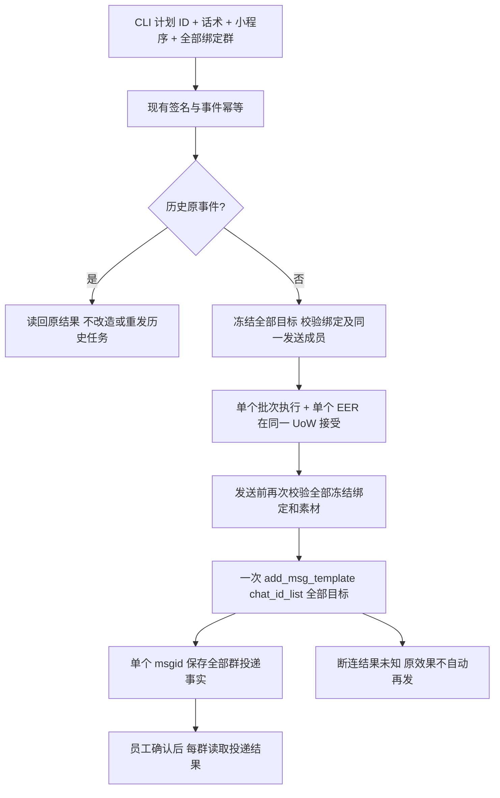

# 同一 Webhook 群运营批次只创建一个企微群发任务

已授权 brief 的修正：计划 12 的一次话术＋小程序推送，目标 11 个绑定群。用户明确要求一个企微任务的 `chat_id_list` 包含全部群；v0.1.3 CLI 已提交一个数组请求，但服务端为每个群生成独立 EER/企微任务，须修正服务器。

参考：现有 `wecomport.GroupMessageRequest.ChatIDs` 本已是数组；[企微创建企业群发](https://developer.work.weixin.qq.com/document/path/92135) 支持指定群数组（最多 2000，终端 4.1.10+），成员确认后发送。沿既有 Group Ops→outbound→External Effects/WeCom Port；不在 CLI 或业务 app 直接访问 Provider。按群仅用于投递结果，不能变为创建多任务的循环。

范围：本次动态 Webhook 单次消息批次。不同内容、发送成员或标准编排节点仍是独立业务发送，不将其混为同一 Provider 任务。所有群必须有同一可信运营成员；超过 Provider 单任务 2000 群拒绝，不悄悄分包。已有 11 个测试任务保持历史事实，不自动重放或改写；改完以新事件验证一个任务。

OneID：不涉及客户主键或身份匹配，只用计划 Owner 返回的稳定群引用。执行：Provider 写沿 outbound/EER；冻结批次、幂等 run/执行/意图与效果同一事务。持久化：复用现有 content snapshot 保存完整目标数组；Group Ops 自有任务中以一条 msgid 及逐群结果记录；现有历史单群快照/回执兼容。只添加必要的前向兼容存储，不新增队列、重试或计时器。无 UI 编码。

验收：一次事件仅一个执行/效果/Provider 写，数组正好 11 群；原事件重放不增加；绑定/成员变化拒绝；Provider 断连保留 unknown不重发；逐群状态匹配、完整分页、部分成功不能冒称全群已送达，已送达事实单调保留。修改后相关单元/PG和实际安装合同通过，再生产验证单任务，最后 GitHub 更新说明与对应版本。
