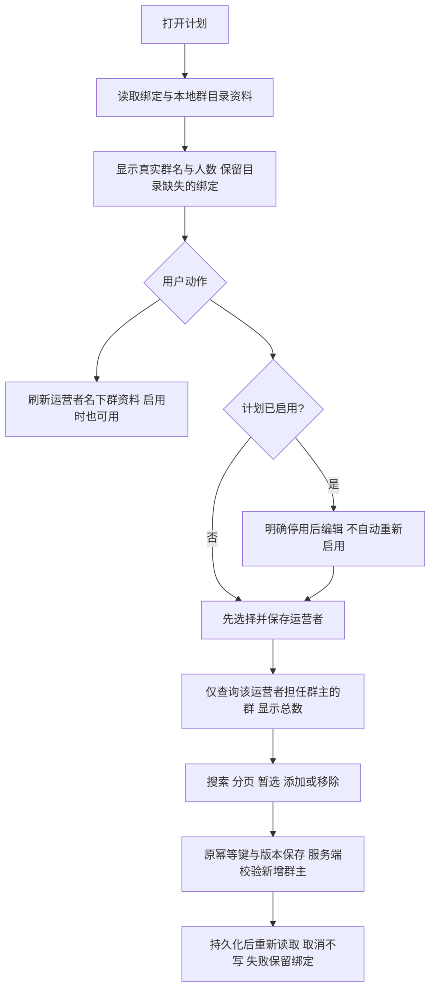

# 群运营绑定群修复

用户授权：登录生产并修复群名、刷新、运营者群主筛选和群绑定增减；沿唯一工作台发布，不发送群消息、不调整现有绑定。

现状证据：2026-10-14 生产计划12启用v5，10个绑定均为“群名称待同步”，绑定页没有刷新/选择按钮；群目录页已有其中的真实群名。Product Design index→user-context preflight→audit，以当前生产截图 `/private/tmp/groupops-before.png` 和原有布局为参考，复用后台单壳、groupOpsStandard、shared/ui/groupPickerAdapter、staffPickerAdapter。可见缺陷：资料映射遗漏、只读区缺少下一步、缺运营者范围和总数；截图不代替保存/权限验收。

参考：读取 [Ant Design 多选搜索/分页及受控选择示例](https://ant.design/components/transfer-cn/)，借鉴搜索、暂选/确认、数量表达，不引入依赖。企微官方客户群列表/详情文档92120/92122当前无法抓取，不引用未读取内容；实际复用本仓WeCom群目录读取Port及完整分页合同。

方案：详情DTO在GroupOps Owner内部左连接群目录，缺资料不丢绑定；刷新复用当前Provider读取及内部jobqueue，不发送消息。基础配置继续先保存可信本地运营者；群选择器只用保存后的群主scope，展示总数、分页和草稿。草稿及停用计划允许增减；启用计划明确提供停用编辑操作，保留现有版本冻结边界；启用时仍可刷新与重新读取目录。新增群由服务端在同一事务校验本地群主和活跃员工，失效/他人群拒绝，历史绑定仍能移除。

OneID：不涉及客户/身份解析；仅已有员工主键与GroupOps拥有的群引用。执行：本地事务+Provider读取+已有内部持久任务；无Provider写入。计划状态、幂等收据、审计、Outbox沿已有同一PG UoW。不新增队列/定时发布/客户匹配。新增限制仅群主校验，依据用户明确要求及错误发送者风险；保存仍用现有CAS。

验收：初次加载与重开真实群名；目录缺失保留群；启用状态可刷新且不改计划版本；停用状态搜索/添加/移除保存回读；其他群主拒绝、重放只保存一次、旧版本拒绝；人数未知保持未知；同步受理与完成分开；原绑定、话术、Webhook保留。相关包及直接页面合同随候选登记，实际安装PG/浏览器验收由唯一发布工作台执行。真实生产只核对当前计划名称/刷新/选择候选，不自选新增生产群，不触发群发。

补充根因：CatalogService.Owner在当前composition中未接线，Provider成功读取会把目录owner_staff_id写成空，导致运营者scope为空。接入Access稳定Port的已有UserByWeComUserID短事务读取，匹配已有活跃员工；未知/停用返回未映射，不创建员工。Provider网络与该事务分离。上线后用户授权刷新目录即可修复既有空投影，计划绑定不变。
现有空群主投影在读取时通过GroupOps拥有的活跃员工目录与原始owner_user_id精确匹配，既有非空群主保持原值；选择和服务端新增共享同一规则，新增另检查Access当前活跃态。无需等全量同步即可从既有可信资料筛选，GET不写库。
