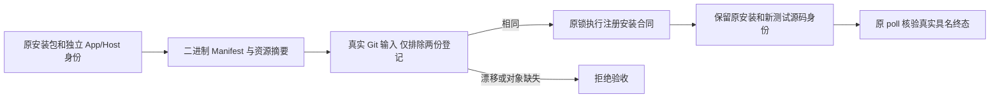
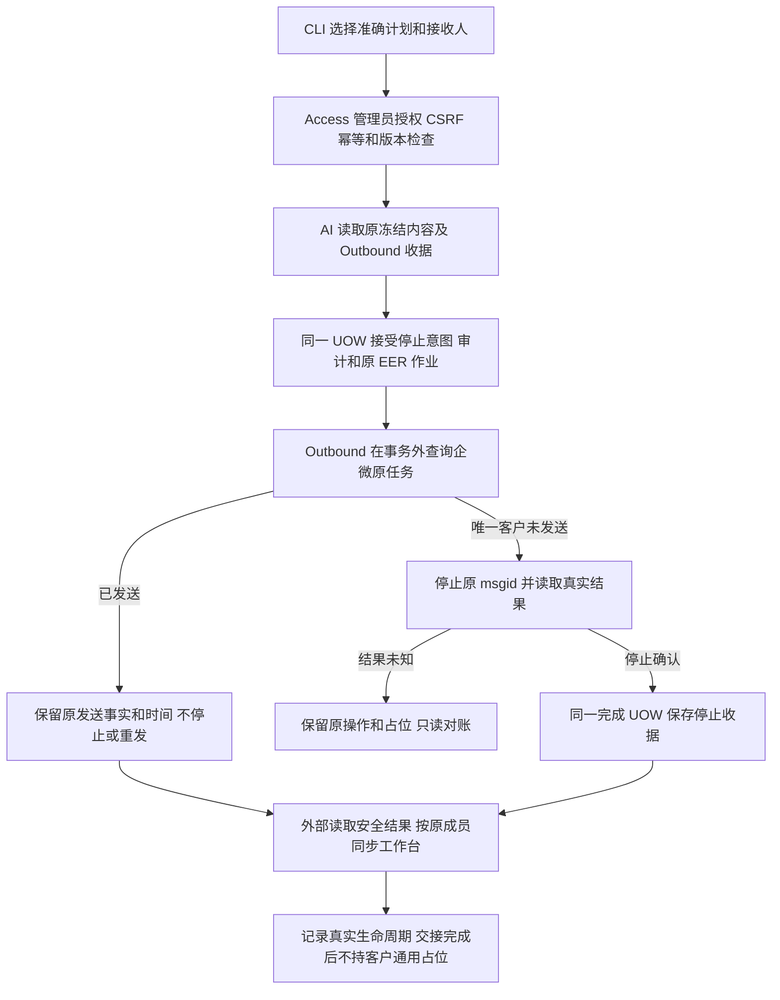

# 已接受企微任务停止与发送事实对账

用户已授权：新增可由外部进程调用的 CLI 能力，给予指定 wecom-staff 账号操作权限；先废弃本次阻挡新稿的旧任务并让出位置。原任务 01a138df-c2b3-7361-b984-1420d4d7f355。基线为国内 main 097afc6c2adf2e1785b005875a1e3184d408aefa。

机械衔接修复：原候选 c6b74c42a1b6b20ea9cc50d102c81acb11ab2c98 及原 ref/收据保留；新线性候选从工作台已验收累计基线 631034f2040d0b56304dd35497909481831a7dba 继续。只移入本轮私信控制差异和机械绑定，既有分享能力保持，新增业务范围为空；OneID 与执行分类沿用本 brief，不重复真实停止或发送。

预发合同修复：应用 361be23 已安装，Host 合法复用 631034f；构建器已排除两份 APPLICATION_SOURCE_REGISTRIES，但控制器与 Go 安装夹具误比较整个 web tree。两处改为真实 Git type/mode/blob/path 的 NUL 记录摘要，仅排除这两份登记，web 根必须仍是 tree。二进制、Host/App 各自 SHA、manifest 与全部资源摘要继续验证。分类为源码-only 控制器/夹具修复，不涉及新身份、业务持久化或 Provider 调用，不改已安装包。原锁/原 in_flight 下使用已检查候选的 stage_check 和准确 test_source_sha 运行注册合同，原 poll 接受具名 JSON 终态；工具安装另按原维护入口处理，不新增恢复状态机。

参考：企业微信停止群发接口的现有客户端实现 https://github.com/golanggo/hzs-wecom/blob/main/external_message.go；官方地址 https://developer.work.weixin.qq.com/document/path/97611。采用冻结 msgid、单客户范围及真实回执；复用 V4 Access、AI 计划、Outbound、External Effects 和 River。比较过只改本地取消状态、直接调用 Provider，以及复用 EER 的停止意图；选择最后一种，避免本地取消冒充企微停止、丢失异步结果或自建重试内核。

OneID：只读取既有客户、接收人及冻结 Provider 目标，不解析新身份、不建客或合并。执行：本地 PostgreSQL UOW、既有内部持久任务、Provider 读取和 Provider 写入。新增必要边界仅为原计划/接收人/版本及单客户 msgid 防止越权或误停同任务其他成员。Provider 网络调用不持有事务；结果未知不换键重试。

CLI 使用既有人类管理员登录，可从外部进程调用。新增 POST /api/admin/ai-assistant/plans/{plan_id}/recipients/{recipient_id}/stop 和安全停止结果读取；输入 expected_version、reason 及 Idempotency-Key。指定账号维持现有管理员权限，增加此操作的 Access 授权规则，不转移唯一超级管理员。未授权、缺 CSRF、错计划、错版本或非单客户任务拒绝。机器主体不冒充员工；本次不新增 OAuth 客户端授权范围。

停止为独立 Outbound 意图与 EER kind。保留原发送 effect、attempt、内容和投递事实；已发送则只对账其真实时间。停止成功、已发送、结果未知和失败分别返回。停止同一原任务永久去重；只读对账在新逻辑请求下允许追加观察，以接收迟到回执。安全结果不包含外部联系人 ID、Token、正文或原始 Provider 响应。

用户在侧对话进一步明确的业务判断优先：Provider 接受后本次交接完成；等待员工发送、送达或停止回执是独立跟踪，不能形成客户通用占位。不同服务节点继续按原审核、原周期和服务预算处理；同包按原 digest/幂等身份重放，同节点仍去重，已停止的同节点可接受经过原审核的新稿。安排次数和实际触达次数分别记录，不因释放交接位置清除预算或伪造发送。工作台按原成员消费真实回执，部分完成批次不整体取消，不自动发送新稿。

本次运营范围为 5 条新稿的原任务：4 条仍未发送时停止；1 条已发送保留并回填事实。执行前重新读原目标和 Provider 状态，保存独立操作收据；另外 3 条无关未发送旧任务不在此次废弃范围内。现有生产操作先按用户明确授权完成，CLI 候选按唯一路由交付预发/生产及独立读回。

验证：Provider 拒绝、HTTP/验签协议、分页和目标不匹配、多目标拒绝、已发送不调用停止、停止与员工发送竞争、超时未知不重试、同键和异键并发去重、事务回滚、原发送记录保留；管理员允许、viewer/无 CSRF 拒绝；真实 HTTP/PG/CLI 从接受、执行到结果读取。检查只覆盖直接包和消费者；不称全仓回归。
