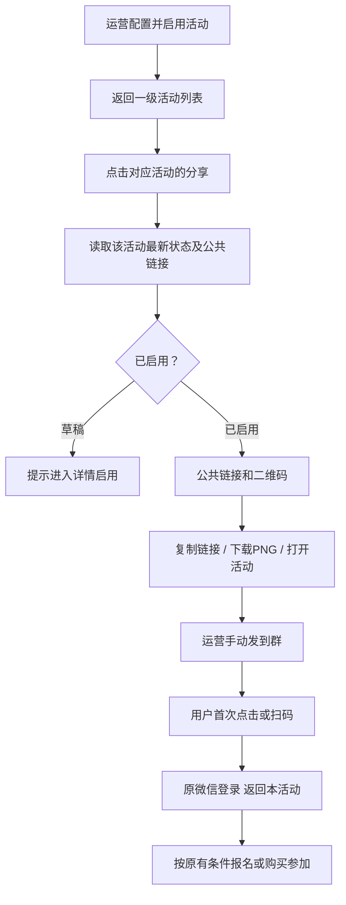

# 裂变活动一级列表「分享」入口 PRD

授权：2026-10-14 用户指定一级活动列表卡片，在「查看活动详情」右侧增加「分享」；仅重做运营入口。父计划已批准，旧统计实现和测试不计作本轮证据。

## 业务流程

## 页面合同

- 唯一新增运营入口位于 `/admin/referral` 每张卡片「查看活动详情」右侧，按钮文字「分享」，同高度、边框和间距；不在详情或设置页常驻增加链接区。
- 点击保持列表路由，弹窗标题「分享活动 · 活动名称」。展示最新状态、完整只读可选链接、二维码和说明「将链接或二维码发到群里，用户即可进入本活动。」
- 操作：复制链接、下载二维码、打开活动、关闭。复制结果真实反馈；失败提示手动选中链接。PNG 文件名「裂变活动-{活动ID}-二维码.png」，整数模块、至少四模块净空。
- 草稿提示尚未启用，不允许分享；已启用未开始提示开始时间；进行中正常分享；已结束/停用允许查看与分享既有入口，明确提示不能参加。
- 读取中展示加载；失败、无权限不生成可用二维码，支持重试。单实例弹窗、取消/迟到响应隔离、多活动不串链接；关闭焦点返回触发按钮。
- 创建成功沿用返回列表，再读取后新卡片立即可点击分享。保存不自动启用。
- H5 不增加公共入口按钮，保持既有生成溯源码、微信登录、免费/购买资格和已上线370px海报。

## 地址与接口

- 管理端 GET `/api/admin/referral/campaigns` 及 GET `/api/admin/referral/campaigns/{id}` 增加绝对 `activity_url`。
- 服务端使用现有 `h5PublicOrigin(cfg)` 生成 `{H5公共域名}/referral?campaign={id}`，不读取浏览器域名、请求Host、客户关系或管理员身份。既有公开接口相对地址合同不改。
- 示例活动5：`https://www.youcangogogo.com/referral?campaign=5`，不带个人邀请参数或管理员信息。
- 分享只进行已有管理员授权读取与浏览器本地复制/下载。不得调用invite签发、创建参与/订单或修改配置。
- OneID：无新增处理；执行：无状态，浏览器本地导出；无数据库持久化/迁移、任务、Provider调用。原OAuth/资格流程沿用既有边界。

## 参考与Product Design

- 视觉目标：用户2026-10-14绿色框截图 `codex-clipboard-d83fa4a8-0282-4db0-838a-8aacf95e65fa.png`，一级列表按钮位置。
- 重新只读审查源：`/Users/qianlan/.codex/visualizations/2026/10/14/01a13858-c651-73e3-81a9-b1f53245c272/referral-operator-redesign/03-production-list.png`；旧原型不是本次基准。
- [Dub Link Builder](https://dub.co/blog/new-link-builder)：链接和二维码同一区域。
- [The Events Calendar GitHub](https://github.com/the-events-calendar/the-events-calendar/blob/main/src/Events/QR/QR_Code.php)：具体活动、后台授权及二维码弹窗。仅借鉴行为，不复制实现，不引入平台/短链。
- Product Design index/get-context/image-to-code，复用既有CRM壳、detailDrawer、renderQr及copyPlainText；实施后design-qa同视口并排比较，修正P0/P1/P2再交付。

## 验收与交付

- 接口：绝对H5地址、Host不能污染、后台/H5跨域部署、多个活动、原鉴权与公开接口兼容。
- UI：位置、最新读取、加载/错误/403/重试、复制失败、草稿/未开始/进行中/结束/停用、连续点击/关闭重开/迟到响应、焦点返回。
- 原生API/PG/Chrome：配置完成回到列表分享、PNG下载并独立解码、无参与/订单/签发写入、未参加用户初始入口、375/430/桌面及既有370海报回归。
- 真实微信登录和手机扫码单列；模拟可信会话不是Provider验收。未验证项明确记录。
- 从最新国内main独立候选，不混入旧统计/归因/零元改动。准备干净准确SHA/tree、相关具名清单与收据，实际推送后读取实时路由投递唯一工作台。默认开发候选交付，生产由工作台按范围授权执行；无迁移。
