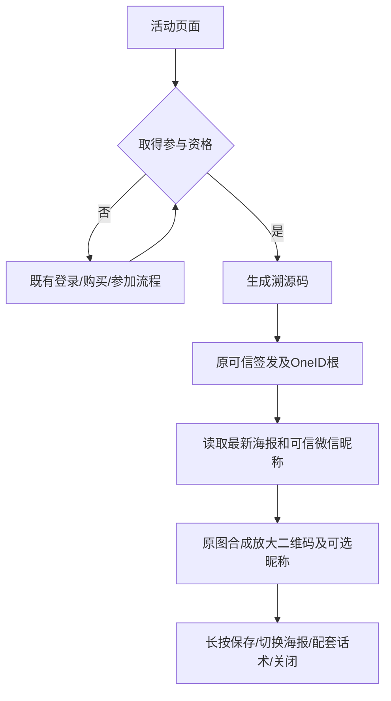

# 裂变海报显示、昵称与溯源码入口

授权：用户2026-10-14明确要求实施已确认父PRD；开发与国内候选交付。国内base a401b5dd90c0d3a3a853654cbdfff62c5be1d0b7。生产安装及活动5配置写入等待相应授权，本任务不安装共享预发/生产。

现状：公开页referralCenter消费领域HTTP，Referral app/store拥有活动、参与、邀请/幂等收据、排行/归因；海报由Referral冻结素材快照及绑定坐标/话术，前端Canvas合成并导出图片。活动5当前1250×2426，原码框830/1952/330。

目标：默认码框810/1932/370，中心保持不变；整数像素边界分配填满码区，净空至少四模块。当前活动5slot1通过既有poster-layouts API带最新expected_version调整并读回；其他已有自定义坐标保留。预览填满可用宽度，取消60vh图片限制，弹窗滚动、原生长按及滑动保留。已参与入口显示“生成溯源码”，其他资格状态保留。

POST invite可选新增poster_nickname；内部签发结果携带已验证OneID根，仅通过Customer WeChatNicknameReader读取真实OAuth昵称，缺失/失败省略，绝不读运营展示名。昵称进入导出图片及合成缓存键：1250宽时30px常规字重，右/上48px，#F7F0DF及轻微棕色阴影，宽度24%，超长按完整字素省略；其他图按宽度缩放。无新请求参数、客户主键、身份匹配、表/迁移、Provider调用或持久任务。现有邀请/布局写及收据审计Outbox原UoW不改，昵称是提交后独立可缺失只读装饰。

分类：OneID读取客户，复用已验证根及Customer Port；执行为既有签发/布局本地事务和浏览器无状态合成；无新外部效果。限制依据：四模块净空保证扫码；昵称24%/省略保证不盖主标题或品牌，不增加业务输入字数配额。

参考：DENSO WAVE https://www.qrcode.com/en/howto/code.html/index.html 四模块净空；现有库 https://github.com/kazuhikoarase/qrcode-generator 。继续复用现有库与组件，不新增依赖。Product Design index/user-context/image-to-code/design-qa已读取并preflight；用户提供截图为视觉基准，原V4组件局部实施，不初始化新应用或生成替代海报。

验证：HTTP可信根/可选失败/不泄露ID/鉴权与CSRF拒绝；实际PG合并后签发/重放根、布局保存读回及自定义坐标保留；前端昵称/完整emoji/空值/重复点击/取消迟到/切换话术/重开缓存；375/430真实浏览器导出原尺寸及独立QR解码，Product Design同状态比较，未覆盖的微信真机保存及真实归因单列。清单与候选准确head同行；国内推送后实时路由实际投递五项影响、结果、未验证项及已有授权。
