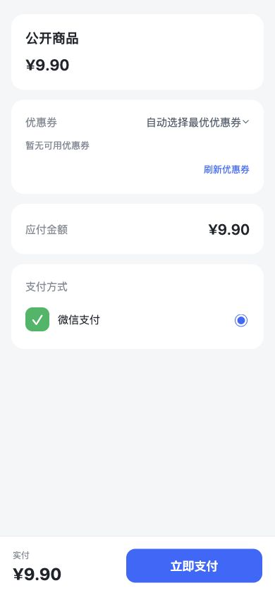
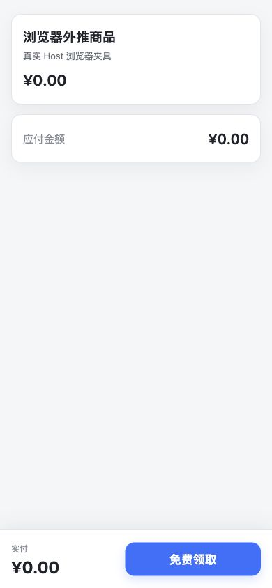
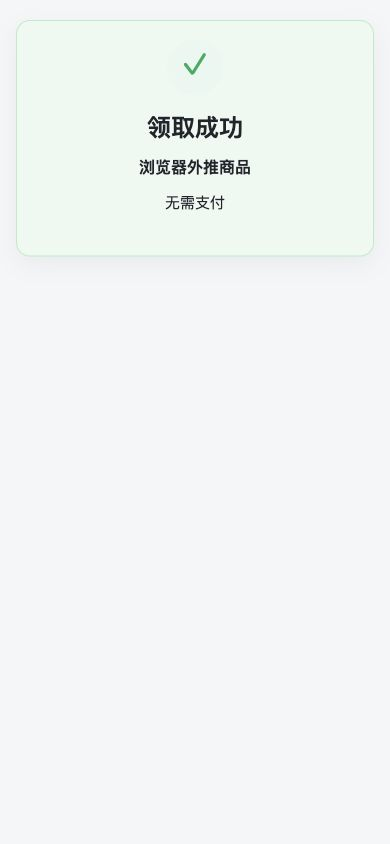

# 零元订单交付验证

实现范围为已批准的[父 PRD](../prd/2026-10-12-zero-amount-orders.md)。初始业务基线是国内 `8245526b89d04111acb2b03f66416b9c10d4064e`，重提交继承工作台最新累计源码；优惠券单元为 `6ba5e2898c53db20a6ae76413ced66df1e10635d`，零元单元继承该提交。准确候选 head/tree/ref 在本任务推送后的交付收据中记录。

普通商品0元无券由原Checkout完成本地订单；周期0元拒绝。券抵扣封顶留1分，核销整券，保存实际抵扣。复用Order create收据、OneID、已购锁、完成事件和履约消费者，无新表、支付Adapter、队列或页面。迁移0240只调整Order约束并限制原生零金额到合法no_payment快照，保留微信小店已有外部金额语义。

改价时整笔拒绝；响应丢失后原请求/原键先重放。商品下架后，认证持有者在原页面读取订单冻结快照；匿名及其他客户仍为404。旧数字链接兼容。续期会话可以按同一OneID读取已购事实，变更原请求的会话绑定仍被拒绝。

Product Design使用现有页面和组件，未生成新组件。免费页隐藏券和支付方式，订单详情隐藏无关退款/分销区块。390×844的同视口截图来自本机隔离夹具，未代表预发或生产。

| 验证 | 结果 |
|---|---|
| Coupon PG金额边界，普通/周期，0/1分不占券、等额/超额券实际核销 | 通过；12个子用例 |
| Checkout期待金额拒绝及回滚；旧nil字段摘要字节兼容 | 通过 |
| 真正1分支付确认后，面额20000分保留，实际抵扣9899分，整券redeemed | 通过；可信回调夹具，未进行真实付款 |
| 同键6并发同一结果、异键6并发已购拒绝、丢响应后改价/下架重放 | 通过；一份订单/收据/完成事件/履约记录 |
| 完成事件、购买后动作、收据及外部效果接受失败 | 通过；整个PG UoW回滚 |
| 外部推送接受及重放 | 通过；一份Outbound意图/效果，0次attempt |
| 更换会话绑定、变更payload、伪造no_payment、其他客户读取 | 拒绝断言通过 |
| 禁止0元退款/开票、无Payment记录及支付效果 | 通过 |
| 已购读回、购买后动作、0金额及空交易号/付款时间导出 | 通过 |
| 付费销售、人群、资格、补录及分销/裂变消费者 | 排除断言通过；正价消费者保留 |
| 正价购买后动作、原有支付宝恢复、旧浏览器checkpoint | 定向回归通过 |
| 原页面免费领取、响应丢失复用同一请求、刷新恢复、差价不自动提交 | JS DOM旅程通过 |
| 真实浏览器→完整Composition→隔离PG领取及改价/下架后的恢复 | 通过；界面领取成功/无需支付，最后PG记录仍各1份 |
| 客户订单、后台订单详情与TypeScript检查 | 通过 |

测试使用本机独立PG16.13集群和临时数据库；新增零元夹具的Effects Worker关闭。未接触运行环境数据库。相关包及具名检查登记于`docs/release-checks.json`。普通包检查为Order domain/app/http、Payment app/http、Outbound、Coupon app；大包cmd/aicrm、Order store、Invoice及Public H5采用具名用例。前端使用`node web/v3/customerOrders.test.mjs`、`node web/v3/orderAdapter.test.mjs`、`npm run typecheck --silent`。

一次并行依赖准备导致临时npm目录缺失；已串行重跑受影响的支付宝恢复和前端检查并通过。Go业务断言的失败与依赖准备失败分别处理。当前本机Node24.21/npm11.19，正式国内构建仍由工作台使用其固定工具链。

尚未验证：国内Linux最终应用构件、共享预发同包旅程、生产迁移/安装及独立读回、真实1分Provider付款，以及实际推送接收方对0金额/空交易字段的兼容。外部推送仅证明本地原子接受和冻结载荷，不表示接收方开通成功。生产迁移前应按既有发布流程备份；不向无法读取no_payment的旧版本盲目回退。两个候选共享一个批次，由唯一工作台最终构建/预发各一次；开发任务不自行安装共享环境；工作台按当前批次规则完成预发后停留，全部完成且用户明确允许后集中生产。





## 实际安装包验收入口

原控制器的收据名为 `coupon-minimum-amount`、`zero-amount-checkout`。共用 `cmd/aicrm/zero_amount_installed_test.go` 的 `TestPostgreSQLZeroAmountInstalledCheckout`，一次调用覆盖：免费完成与购买后动作、同键/异键、改价下架恢复与匿名拒绝、安装服务器计算的付费商品统计排除、券最低1分及差价回滚、免费订单无Payment/Provider attempt。它复用既有 InstalledProduct 校验与安装二进制启动/TLS Proxy；源码 Composition 只准备临时客户/会话/商品及事实读回。所有行为断言都由实际安装二进制和同包 Host 处理。

在准确最终累计源码的干净 checkout 中执行（具体绝对路径和摘要从实际安装收据填写，不用占位参数作为通过证据）：

```sh
export AICRM_INSTALLED_PRODUCT_BINARY=/absolute/package/bin/aicrm
export AICRM_INSTALLED_PRODUCT_ROOT=/absolute/package
export AICRM_INSTALLED_PRODUCT_SHA=EXACT_FINAL_SHA
export AICRM_INSTALLED_PRODUCT_BINARY_SHA256=EXACT_BINARY_SHA256
export AICRM_REQUIRE_ZERO_INSTALLED=1
export AICRM_DATABASE_URL=LOOPBACK_AICRM_TEST_DATABASE_URL
bash scripts/run-go-with-donor-views.sh go test -json -p 1 -count=1 -timeout=5m \
  -run '^TestPostgreSQLZeroAmountInstalledCheckout$' ./cmd/aicrm
```

数据库必须是明确的 loopback `aicrm_test_*` 隔离库，运行过程自行克隆独立接受库；不使用运行环境数据库。安装进程为API角色，关闭Effects执行能力，并用失败代理阻止真实外网访问；券1分只创建付款意图，不发起真实付款。成功输出必须包含 `installed_zero_amount: PASS` 和实际源码/二进制摘要。缺输入时 `AICRM_REQUIRE_ZERO_INSTALLED=1` 直接失败，不能算skip通过。

本机只完成安装验收夹具的源码模式诊断与编译；它明确输出 `source composition only, installed acceptance remains unverified`，不作为实际安装包收据。真实安装包结果由工作台最终安装后执行并保存在原stage-evidence。
